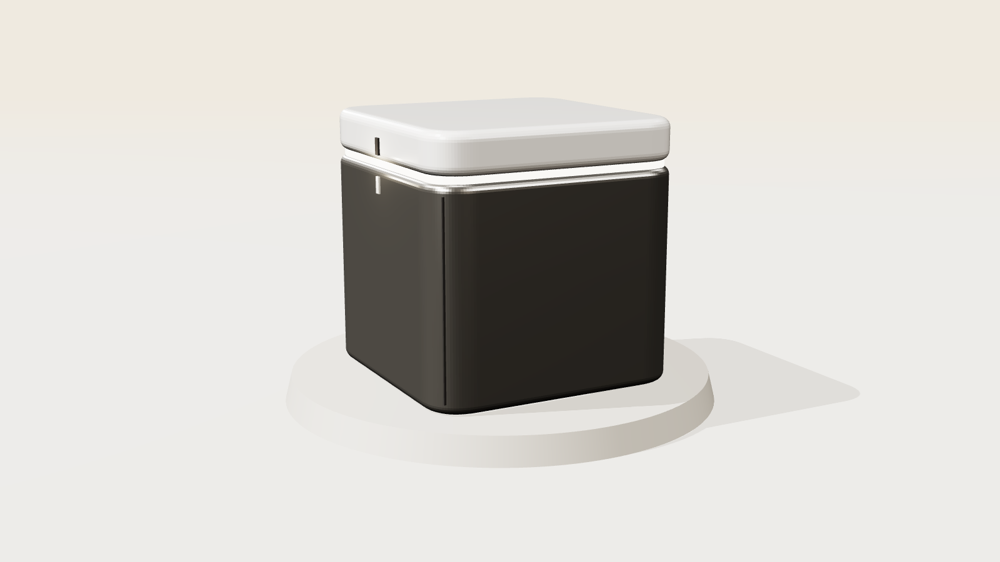
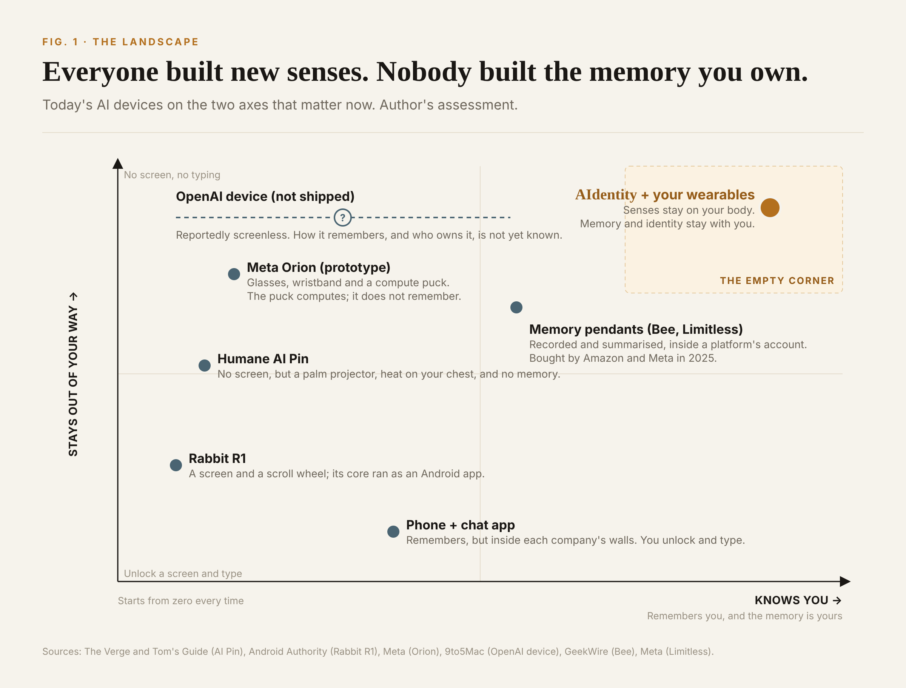
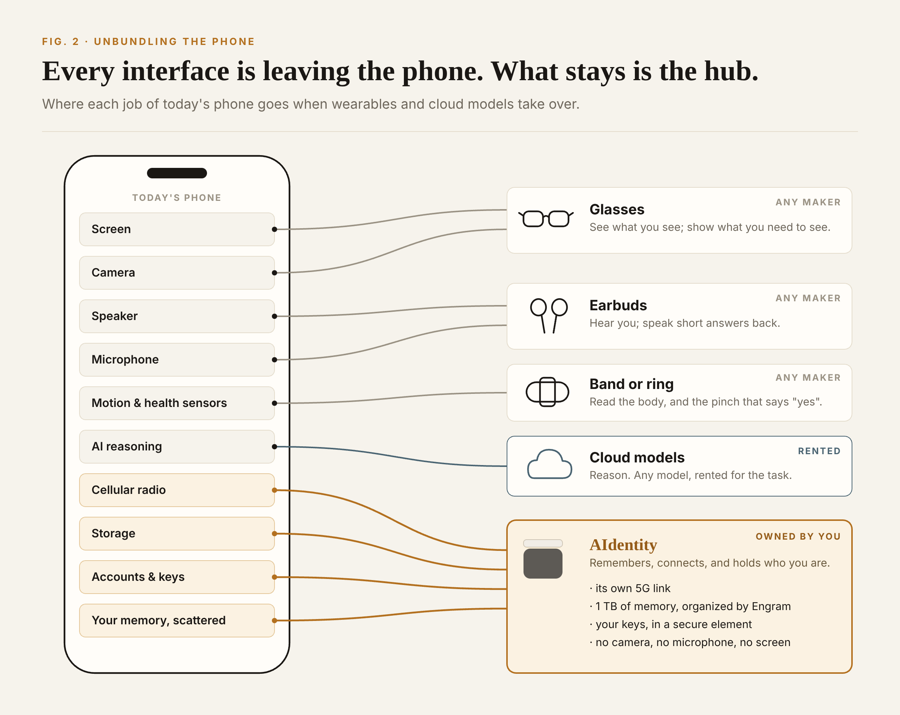
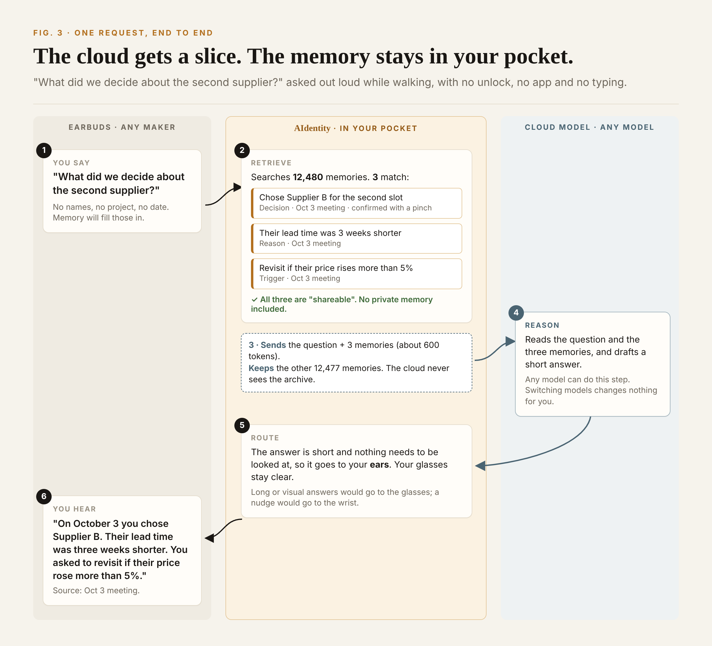
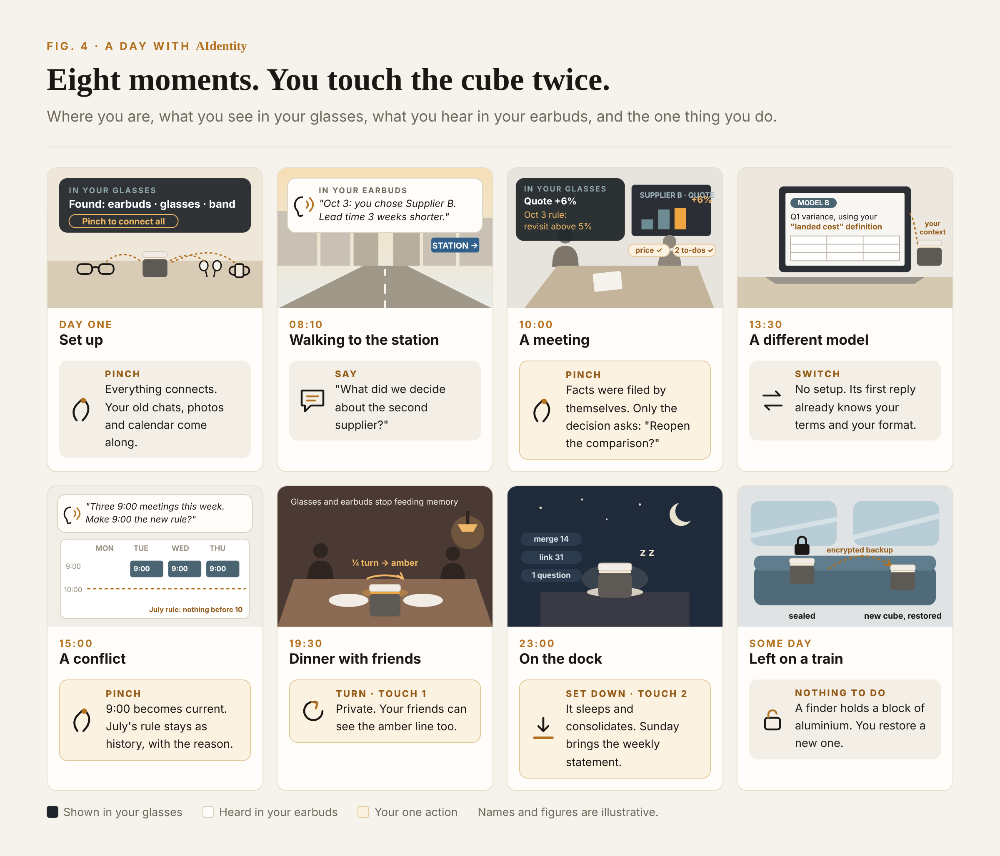
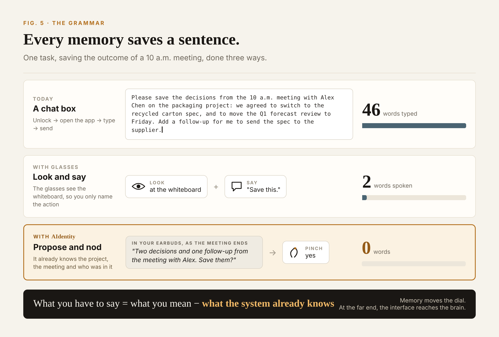
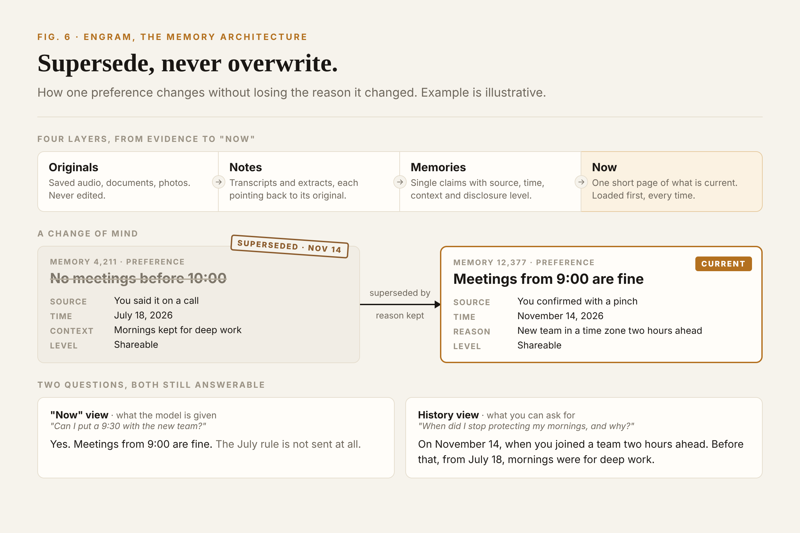
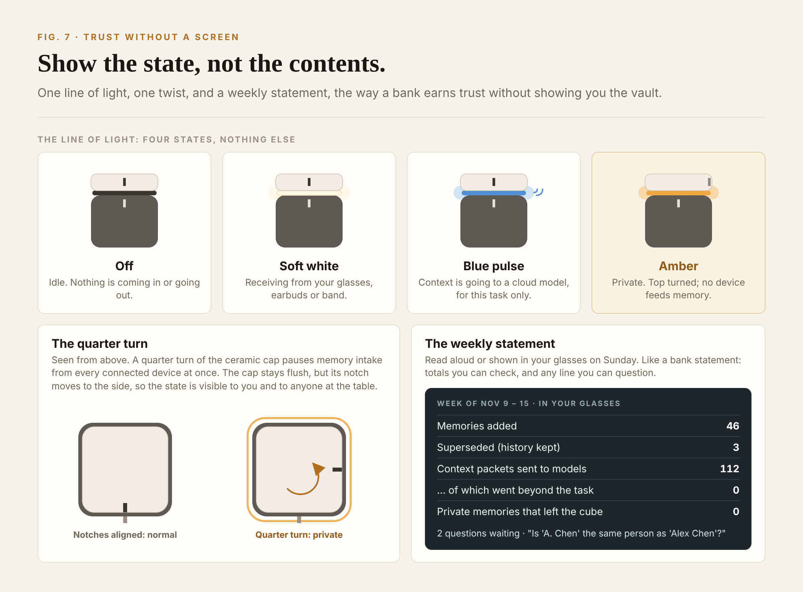
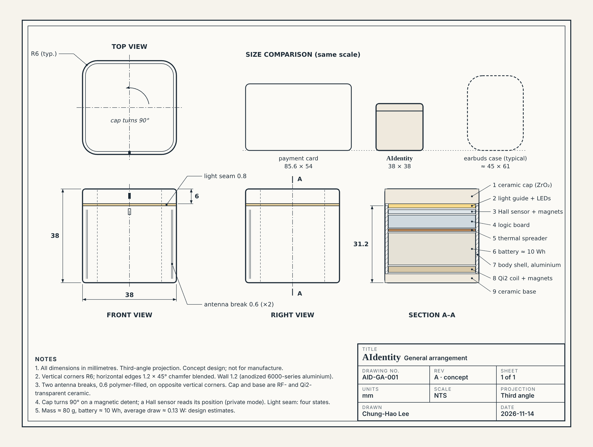
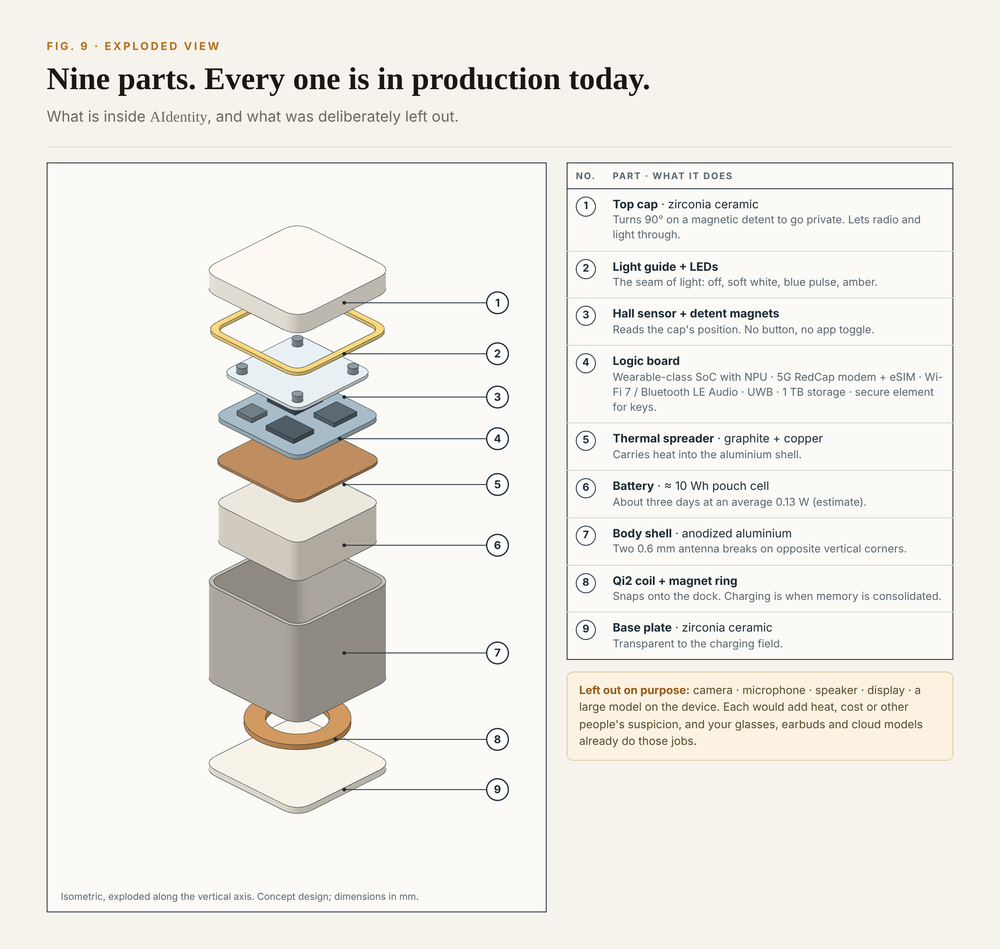

+++
date = '2026-11-15T00:00:00+10:00'
title = "AIdentity: Designing the Hardware of the AI Era — Models Are Rented. Identity Is Owned."
tags = ['Product Decoder', 'Product Design', 'AI', 'PM', '中文']
thumbnail = 'pic.png'
+++

## AIdentity：設計 AI 時代的硬體——模型可以租，身份要自己擁有

<figure style="margin: 2em 0;">
  
  <figcaption style="margin-top: .6em; font-size: .82em; line-height: 1.55; opacity: .7; text-align: left;">
    AIdentity: no camera, no microphone, no screen. It remembers, connects and holds who you are. 
    AIdentity：沒有鏡頭、沒有麥克風、沒有螢幕。它負責記憶、連結，保管「你是誰」。
  </figcaption>
</figure>

At 8:10 a.m., walking to the station, you ask a question out loud: "What did we decide about the second supplier?"

早上 8 點 10 分，你走在去車站的路上，隨口問了一句：「第二家供應商，我們最後怎麼決定的？」

Your earbuds answer before you reach the corner. "On October 3 you chose Supplier B. Their lead time was three weeks shorter. You asked to revisit it if their price rose more than 5%."

還沒走到轉角，耳機就回答了：「10 月 3 日那場會，你選了 B。他們的交期短三週。你也交代過，如果價格漲超過 5%，要重新評估。」

You did not unlock anything. You did not type. You did not explain who "we" were, which supplier, or which project. And the device that answered never heard the meeting. It has no camera, no microphone and no screen. It is a small cube in your pocket, and its whole job is to remember.

你沒有解鎖任何東西，也沒有打字。你沒有解釋「我們」是誰、哪一家供應商、哪一個專案。更有意思的是，回答你的那台裝置根本沒有參加那場會。它沒有鏡頭，沒有麥克風，也沒有螢幕。它只是口袋裡的一個小方塊，唯一的工作就是記得。

For two years, AI hardware has been a race to build new eyes and ears: a camera on your chest, a microphone around your neck, a display projected onto your palm. Plenty of them shipped. Few of them stayed.

過去兩年，AI 硬體的戰場擠滿了新的眼睛和耳朵：別在胸前的鏡頭、掛在脖子上的麥克風、投影在掌心的螢幕。做出來的產品不少，留下來的不多。

I think the industry has been building the wrong part. The missing piece is the one that just answered you: a device that cannot see or hear, yet remembers what matters to you, and belongs to no one but you.

我認為大家都造錯了那一塊。真正缺的，是剛才回答你的那一塊：一個看不見也聽不到，卻記得你在意的每件事，而且只屬於你的東西。

In this piece I design it from scratch: the problem it solves, a day of using it, why it looks the way it does, all the way down to the engineering drawings.

這篇文章，我想把它從頭設計出來：它解決什麼問題、一天怎麼用、為什麼長這個樣子，一路畫到工程圖。

It is also the question my last few essays kept circling. [*Google's AI Pointer*](/posts/product-decoder_google-ai-pointer/) was about expressing intent in as few words as possible. [*When AGI Moves In*](/posts/when-agi-moves-in/) was about an assistant that sees what you see and hears what you hear. [*Learning from Records of the Grand Historian*](/posts/learning-from-records-of-the-grand-historian/) was about memory that keeps its sources and its contradictions. This piece puts all three into one product.

這也是我過去幾篇文章一直繞著的問題。〈[Google 的 AI Pointer](/posts/product-decoder_google-ai-pointer/)〉談怎麼用最少的話表達意圖，〈[When AGI Moves In](/posts/when-agi-moves-in/)〉談 AI 怎麼看你所看、聽你所聽，〈[借鑑《史記》的智慧](/posts/learning-from-records-of-the-grand-historian/)〉談記憶要怎麼保留來源和矛盾。這一篇，把三者收進同一個產品。

## Three Things Wrong with AI Today // 今天的 AI，有三個問題

**It does not know you.** ChatGPT and Claude both remember now, but each remembers inside its own walls. The context you build in one does not travel to the other. Every new tool starts close to zero, and you pay the same description tax again: restating, in words, what you have already told some other machine.

**第一，它不認識你。** ChatGPT 和 Claude 現在都有記憶了，但各自記在自己的圍牆裡。你在這邊累積的背景，帶不到那邊去。每換一個工具，幾乎都要從頭開始；你一次又一次繳同一筆「描述稅」，把已經告訴過別台機器的事，再用文字講一遍。

**Your devices do not know each other.** Glasses, earbuds and a watch each come with their own app, their own account and their own idea of who you are. The hub that connects them is still the phone, which means the most distracting object in your life sits in the middle of every request.

**第二，你的裝置彼此不認識。** 眼鏡、耳機、手錶，各有各的 App，各有各的帳號，也各有各的「你」。把它們串起來的中樞，仍然是手機。也就是說，你生活中最會打斷你的那個東西，永遠站在每一次請求的正中間。

**Your identity is rented.** Your AI self, meaning your preferences, your history and the context that makes an answer fit you, lives in the account of whichever company you happen to use. Change models and you start over.

**第三，你的身份是租來的。** 你的偏好、你的歷史、讓答案剛好合身的那些脈絡，構成了「AI 眼中的你」。這個你，住在你剛好使用的那家公司的帳號裡。換一個模型，就要從零開始。

Several serious companies have tried to fix this with new hardware. In 2007 Steve Jobs opened the iPhone launch with a simple chart: phones on two axes, "smart" and "easy to use," with every rival stuck in the wrong corner. The same chart works for today's AI devices if we change the axes to the two things that matter now. Does it know you? Does it stay out of your way?

不少認真的公司都試過用新硬體解決這件事。2007 年，賈伯斯發表 iPhone 時，開場就畫了一張很簡單的圖：兩條軸，一條是「聰明」，一條是「好用」，當時所有的對手都卡在錯的角落。把軸換成今天真正重要的兩件事，這張圖依然適用：它懂不懂你？它會不會擋在你面前？

<figure style="margin: 2em 0;">
  
  <figcaption style="margin-top: .6em; font-size: .82em; line-height: 1.55; opacity: .7; text-align: left;">
    The author's assessment. Every attempt so far built new senses; none built the memory you own. 
    作者的評估。至今的嘗試都在造新的感官，沒有一個造出屬於你的記憶。
  </figcaption>
</figure>

**Humane AI Pin** cost $699 plus $24 a month. It projected a monochrome display onto your palm that was hard to read in sunlight, and it ran hot on your chest. By the summer of 2024, according to The Verge, returns were outpacing sales. In February 2025 HP paid $116 million for most of the team and more than 300 patents, and on February 28 the pins lost their cloud service.

**Humane AI Pin** 售價 699 美元，每月另收 24 美元。它把單色畫面投影在你的掌心，在陽光下幾乎看不清楚；別在胸前，還會發燙。根據 The Verge 的報導，到了 2024 年夏天，退貨已經比賣出去的還多。2025 年 2 月，HP 以 1.16 億美元買下大部分團隊和三百多項專利；2 月 28 日起，AI Pin 的雲端服務全面關閉。

**Rabbit R1** cost $199 and promised a "large action model" that would use apps for you. Reviewers found the demos did not work, and Android Authority showed its core experience running as an app on an ordinary Android phone. A device that can be an app has no reason to be a device.

**Rabbit R1** 售價 199 美元，主打一個會替你操作 App 的「大型行動模型」。評測者發現展示的功能根本跑不起來；Android Authority 更證明，它的核心體驗可以當成一個 App，裝在一般 Android 手機上執行。一台能被做成 App 的裝置，就沒有理由是一台裝置。

**Meta's Orion**, shown in September 2024, is the most impressive of the group and the closest to a hub: glasses, an EMG wristband and a pocketable "compute puck" that holds the battery and the chip. But the puck serves one pair of Meta glasses, and it computes rather than remembers. Meta has said consumers will never get it.

**Meta 的 Orion** 在 2024 年 9 月亮相，是這群產品裡最驚豔、也最接近「中樞」概念的一個：一副眼鏡、一條 EMG 手環，再加上一個放在口袋裡、裝著電池和晶片的「運算盒」。但這個運算盒只服務一副 Meta 眼鏡，而且它負責的是算，不是記。Meta 也說過，這款產品不會賣給消費者。

**OpenAI and Jony Ive's team** are reportedly building a screenless, context-aware device. A court filing in February 2026 said it would not ship before the end of February 2027.

**OpenAI 和 Jony Ive 的團隊**據報導正在做一台沒有螢幕、能感知周遭情境的裝置。2026 年 2 月的一份法院文件指出，它最快也要到 2027 年 2 月底之後才會出貨。

The closest attempts to my idea were the memory pendants. **Bee** recorded and summarized your conversations from a wristband; Amazon agreed to buy it in July 2025. **Limitless** did the same from a pendant; Meta bought it in December 2025 and stopped selling the device.

最接近我這個想法的，是那些記憶型穿戴裝置。**Bee** 用一條手環錄下並摘要你的對話，2025 年 7 月 Amazon 同意收購。**Limitless** 用一個墜飾做同樣的事，2025 年 12 月被 Meta 收購，隨即停止販售。

The pattern is hard to miss. Each product tried to build a new set of senses, a camera on your chest or a microphone around your neck or a display in your palm, and then hoped a mind would grow behind them. The memory pendants came closest, and they were absorbed into platforms that already own your account. Nobody has built the piece in the middle that you own.

規律其實很明顯。每一個產品都想造一套新的感官：胸前的鏡頭、脖子上的麥克風、掌心裡的螢幕，然後期待後面自己長出一顆腦。記憶型裝置走得最近，卻被那些本來就握著你帳號的平台收編了。中間那一塊真正屬於你的東西，到現在還沒有人做出來。

---

## The Insight: Let Each Part Do What It Does Best // 洞察：讓每個部分做自己最擅長的事

Start with what humans are good at. The human eye and ear are the product of hundreds of millions of years of evolution. Wearables now sit exactly where they are: glasses at the eye, earbuds at the ear, a band at the wrist.

先看人擅長什麼。人的眼睛和耳朵，是上億年演化出來的感測器。而穿戴裝置現在剛好就戴在那裡：眼鏡在眼前，耳機在耳邊，手環在手腕上。

Then ask what AI is good at. Its edge is not sensing the world. It is making sense of what was sensed: sorting thousands of fragments, connecting them, remembering them and finding the right one in a second.

再看 AI 擅長什麼。它的長處不是感知世界，而是消化感知到的東西：把成千上萬的片段分類、串連、記住，再在一秒內找出你要的那一片。

That gives a division of labor. The senses perceive. The cloud models reason. A hub remembers and connects. The person judges. This is comparative advantage, not absolute advantage: even if a device could see and hear, it should not, because your glasses and earbuds already do that from a better position.

分工於是很清楚。感官負責感知，雲端模型負責推理，中樞負責記憶與連結，人負責判斷。這是比較優勢，不是絕對優勢。就算一台裝置做得到看和聽，它也不該這麼做，因為你的眼鏡和耳機已經在更好的位置上做這件事了。

Now look at the phone through the same lens. Its screen is moving to the glasses. Its speaker and microphone are moving to the earbuds. Its camera is moving to the glasses, its body sensors to the band and the ring, and its reasoning to the cloud. What remains is the radio, the storage, your accounts, your memory and a battery.

用同樣的眼光看手機。它的螢幕正在搬去眼鏡，喇叭和麥克風正在搬去耳機，鏡頭搬去眼鏡，身體感測搬去手環和戒指，推理搬去雲端。剩下的，是通訊晶片、儲存、你的帳號、你的記憶，還有一顆電池。

<figure style="margin: 2em 0;">
  
  <figcaption style="margin-top: .6em; font-size: .82em; line-height: 1.55; opacity: .7; text-align: left;">
    Unbundling the phone. What is left after the interfaces leave is a hub, and a hub needs no screen. 
    手機被拆開之後，剩下的是中樞，而中樞不需要螢幕。
  </figcaption>
</figure>

In July I gave that remainder to the phone. Following the same logic one step further, once the screen leaves, the phone's last job is to be the hub, and a hub does not need a screen. That remainder is the product.

今年七月，我把這塊剩下的角色交給了手機。順著同一個邏輯再往前走一步：當螢幕離開，手機最後的工作就只剩下當中樞，而中樞不需要螢幕。這塊剩下的東西，就是這個產品。

The idea is old. In 1945 Vannevar Bush imagined the Memex, "an enlarged intimate supplement" to a person's memory. He had microfilm and levers. We have 5G modems, terabyte storage and models that can read.

這個念頭其實很老。1945 年，Vannevar Bush 構想過一台叫 Memex 的機器，稱它是人類記憶「一個擴大而私密的補充」。他手上只有微縮膠片和機械槓桿；我們手上有 5G 晶片、TB 級的儲存，還有讀得懂文字的模型。

---

## The Product: A Memory, a Hub, an Identity // 產品：一個記憶、一個中樞、一個身份

Jobs introduced the iPhone as three things: an iPod, a phone and an internet communicator. Then he said they were not three devices but one.

賈伯斯當年介紹 iPhone 時，說它是三樣東西：一台 iPod、一支手機、一台網路通訊器。接著他說，這不是三台裝置，是一台。

This product is also three things. It is a memory, a hub and an identity. They are not three devices. It is one, and I call it **AIdentity**. It is pronounced "identity," because that is what it holds.

這個產品也是三樣東西：一個記憶、一個中樞、一個身份。它們不是三台裝置，是一台。我叫它 **AIdentity**，念作 identity，因為它保管的就是你的身份。

**A memory.** It keeps what is worth keeping: the decisions and deadlines from your meetings, to-dos, documents, photos from your glasses. The AI judges what is worth keeping; real decisions still wait for your nod. It stores them on the device and organizes them with a memory architecture I call **Engram**, after the neuroscience term for the physical trace a memory leaves in the brain.

**一個記憶。** 它保存值得留下的東西：會議裡的決定和交期、待辦、文件、眼鏡拍下的照片。什麼值得留，由 AI 判斷；真正的決定，再由你點頭。這些都存在方塊裡，由一套我稱為 **Engram** 的記憶架構整理。Engram 是神經科學的名詞，指記憶在大腦裡留下的實體痕跡。

**A hub.** One pairing connects every wearable you own, whoever made it, through open standards such as Bluetooth LE Audio. Its own 5G link reaches any cloud model, and it sends each answer to the right place: something short goes to your ears, something you need to look at goes to your glasses, and a nudge goes to your wrist.

**一個中樞。** 不管是哪個品牌的穿戴裝置，配對一次就全部接上，靠的是 Bluetooth LE Audio 這類開放標準。它有自己的 5G 連線，可以接任何雲端模型，並把每個答案送到對的地方：短的回答送進耳朵，需要看的送到眼前，輕輕的提醒送到手腕。

**An identity.** It holds the keys that sign you in and the context that makes answers fit you. Any model can be your brain for a task. None of them owns you. **Models are rented. Identity is owned.**

**一個身份。** 它保管讓你登入的金鑰，也保管讓答案合身的脈絡。任何模型都可以在某個任務上當你的大腦，但沒有一個模型擁有你。**模型可以租，身份要自己擁有。**

<figure style="margin: 2em 0;">
  
  <figcaption style="margin-top: .6em; font-size: .82em; line-height: 1.55; opacity: .7; text-align: left;">
    One request, end to end. The cloud sees only the slice of memory the task needs; the archive never leaves the cube. 
    一個請求的完整旅程。雲端只看到這個任務需要的那一小片記憶，完整的檔案從不離開方塊。
  </figcaption>
</figure>

What it leaves out matters as much: no camera, no microphone, no speaker, no screen, no large model on the device.

它「沒有」的東西同樣重要：沒有鏡頭，沒有麥克風，沒有喇叭，沒有螢幕，也不在裝置上跑大模型。

Think back to 1998. Yahoo, the giant of the day, was a portal: a directory, news, email and shopping crowded onto one homepage. Google launched with a logo and a search box, and put everything into one job: search, done better than anyone else. Two years later, Yahoo was using Google to power the search results on its own site.

這讓我想起 1998 年的網路。當時的霸主 Yahoo 做的是入口網站，目錄、新聞、信箱、購物，全擠在同一個首頁上。Google 上線時，首頁只有一個標誌和一個搜尋框，所有力氣都花在一件事：把搜尋做到比誰都好。兩年後，Yahoo 自己網站上的搜尋結果，改由 Google 提供。

Less is more only when the "less" is the thing you are best at. AI hardware so far has taken Yahoo's road, cramming cameras, projectors, speakers and processors into one device and paying for it in heat, battery life, cost and other people's trust. AIdentity takes Google's road. It does one job, remembering you and connecting your devices, and leaves everything else to the devices that do it better.

少即是多，前提是那個「少」，剛好是你最強的地方。AI 硬體到目前為止走的都是 Yahoo 的路：鏡頭、投影、喇叭、處理器全塞進一台裝置，最後用發熱、續航、成本和別人的信任來買單。AIdentity 走 Google 的路，只做一件事：記住你，並把你的裝置連起來。其他的，交給更擅長的裝置。

---

## A Day with AIdentity // 和 AIdentity 的一天

First, where its memories come from. Your glasses and earbuds are its senses, its input. But it does not record everything all day. That would be far too much data, and most of it would mean nothing. The real work is judgment: the AI decides what matters and what is worth keeping.

先說它的記憶從哪裡來。眼鏡和耳機是它的感官，負責輸入；但它不會二十四小時錄下一切。那樣資料量太大，大部分也沒有意義。真正的工作在於判斷：什麼重要、什麼值得記，由 AI 自己決定。

Say you are in a meeting. When the conversation turns to a supplier, a lead time or who owes what by next week, those get recorded; the small talk does not. And nothing is filed alone. The lead time attaches itself to the supplier decision you made last month, and a new to-do hangs under the project it belongs to. The more it remembers, the better it knows what matters to you, so the filter keeps getting sharper.

比如你正在開一場會。會議談到供應商、談到交期、談到誰下週要交什麼，這些會被記下來；閒聊和寒暄不會。記下來的東西也不會孤零零一條：交期會自動接上你上個月做過的那筆供應商決定，新的待辦會掛到它所屬的專案底下。記得越多，它越知道什麼對你重要，篩選也就越準。

What it keeps is your meetings, your decisions and your relationships. That is personal, sensitive information by nature, and it is exactly why it has to live in your own AIdentity, belonging to you alone, not on any company's servers.

它記下的，是你的會議、你的決定、你的人際關係。這些資訊天生就高度個人、高度敏感，所以才必須存在你自己的 AIdentity 裡，只屬於你，而不是放在任何一家公司的伺服器上。

**Day one.** You put the cube on the table. Your glasses show the devices it found nearby: earbuds, glasses, a band. You pinch once and all of them connect. You point it at your existing history, such as exported chat records, photos and a calendar, and it starts building your memory that night. A memory device is empty on its first day, so its first-day value has to come from connecting everything at once and from bringing your past with you.

**第一天。** 你把方塊放在桌上，眼鏡隨即列出它在附近找到的裝置：耳機、眼鏡、手環。你捏一下手指，全部接上。接著你把舊資料交給它，包括匯出的對話紀錄、照片和行事曆，它當晚就開始建立你的記憶。記憶裝置在第一天一定是空的，所以它第一天的價值，只能來自兩件事：一次接好所有裝置，以及把你的過去一起帶過來。

**8:10, walking.** You ask about the supplier. The answer comes with its source: October 3, the meeting where you confirmed the decision. When AIdentity uses a memory, it tells you where the memory came from.

**8:10，走路。** 你問起那家供應商，答案附帶來源：10 月 3 日，你確認那個決定的會議。只要 AIdentity 用到一條記憶，它就會告訴你那條記憶從哪裡來。

**10:00, a meeting.** The conversation turns to Supplier B's new quote: up 6%. A line appears in your glasses: "On October 3 you asked to revisit if their price rose more than 5%." When the meeting ends, the new price, the lead time and two to-dos have already been filed and linked to the October decision. Only the real decision gets a question in your earbuds: "Reopen the supplier comparison. Save?" You pinch once.

**10:00，開會。** 會議談到供應商 B 剛寄來的新報價：漲了 6%。你的眼鏡上浮出一行字：「10 月 3 日你交代過，漲幅超過 5% 要重新評估。」會議結束時，新報價、交期和兩項待辦都已經自動記下，並接上十月那筆決定。只有真正的決定，耳機才會問你：「改成重新比價，要存嗎？」你捏一下手指。

**13:30, a new model.** You try a different AI model for a piece of analysis. Its first reply already uses your project's terms and your preferred format, because your context arrived with your identity rather than living in someone else's account.

**13:30，換一個模型。** 你用另一個 AI 模型做一份分析。它的第一句回覆，就已經用上你專案裡的術語和你習慣的格式，因為你的脈絡是跟著你的身份走的，不是住在別人的帳號裡。

**15:00, a conflict.** "In July you said no meetings before 10. This week you accepted three at 9. Should 9 be the new rule?" You pinch. The July rule is not deleted. It is marked as superseded, with the date and the reason, so a future question about why you changed your mind still has an answer.

**15:00，衝突。** 「七月你說早上十點前不開會，這週你卻接了三場九點的會。要把九點改成新規則嗎？」你捏一下手指。七月那條規則沒有被刪掉，而是標上「已被取代」，附上日期和理由。哪天你想知道自己當初為什麼改變主意，仍然找得到答案。

**19:30, dinner with friends.** You give the top of the cube a quarter turn. The thin line of light around it turns amber, and every connected device stops feeding your memory. Your friends can see it too.

**19:30，和朋友吃飯。** 你把方塊的頂蓋轉四分之一圈，繞著方塊的那一圈細光變成琥珀色，所有連著的裝置都停止往記憶裡送東西。朋友也看得到。

**23:00, the dock.** You set the cube on its base and it "sleeps." Like the brain during sleep, it uses the night to consolidate: it removes duplicates, links related memories, flags conflicts and prepares tomorrow's questions. On Sunday you get a short statement of what changed that week.

**23:00，回到底座。** 你把方塊放上充電座，它「睡著了」。就像大腦利用睡眠整理記憶，它也利用夜晚做整理：去掉重複、串起相關的記憶、標出衝突、準備好明天要問你的問題。到了週日，你會收到一份簡短的「記憶存摺」，告訴你這一週有哪些變化。

**Lost on a train.** Away from your wearables, the cube locks itself, so whoever finds it has a sealed block of aluminium. You buy a new one and restore it from an encrypted backup that only you can unlock. For a product named after your identity, the answer to "What if I lose it?" has to be part of the design from the start.

**遺落在火車上。** 離開你的穿戴裝置之後，方塊會自動上鎖，撿到的人拿到的只是一塊封住的鋁。你買一顆新的，用只有你能解開的加密備份還原。一個以「身份」命名的產品，「掉了怎麼辦」必須從第一天就寫進設計裡。

<figure style="margin: 2em 0;">
  
  <figcaption style="margin-top: .6em; font-size: .82em; line-height: 1.55; opacity: .7; text-align: left;">
    A day with AIdentity. You touch the cube twice: to go private, and to put it to sleep. 
    和 AIdentity 的一天。你只碰了方塊兩次：一次切到私密模式，一次讓它入睡。
  </figcaption>
</figure>

Across that whole day, you used one grammar. **Look** at something to name the noun. **Say** the verb. **Pinch** to confirm. Memory fills in the rest.

這一整天，你只用了一套語法：**看**，指出名詞；**說**，講出動詞；**捏**，表示確認。其餘的，交給記憶補上。

This also resolves a tension in my own earlier essays. I have argued that speaking is the fastest way to express intent, and also that nobody should have to say a paragraph when a single click would do. Both claims are true, because they describe two ends of the same dial:

這也化解了我自己過去文章裡的一個矛盾。我說過，說話是表達意圖最快的方式；我也說過，能按一下解決的事，不該逼人講一大段話。兩句話都對，因為它們講的是同一個旋鈕的兩端：

> **What you have to say = what you mean − what the system already knows.**

> **你需要說的話 ＝ 你的意圖 － 系統已經知道的事。**

<figure style="margin: 2em 0;">
  
  <figcaption style="margin-top: .6em; font-size: .82em; line-height: 1.55; opacity: .7; text-align: left;">
    The same task, three generations of interaction. Every memory saves a sentence. 
    同一件事，三代交互方式。每多一份記憶，就少說一句話。
  </figcaption>
</figure>

In a chat box today, saving the outcome of a meeting takes a 46-word prompt. With glasses, you look at the whiteboard and say "save this." With AIdentity, which already knows the project, the meeting and who was in it, the AI proposes and you pinch. **Every memory saves a sentence.** At the far end of the dial, when interfaces finally reach the brain, the sentence disappears altogether.

在今天的對話框裡，要存下一場會議的結論，你得打一段 46 個英文單字的 prompt。戴上眼鏡，你看著白板說一句「存下來」。有了 AIdentity，它本來就知道這個專案、這場會、在場有誰，於是 AI 提案，你捏一下。**每多一份記憶，就少說一句話。** 旋鈕轉到最底，等介面終於直達大腦的那一天，這句話也會消失。

---

## Why It Is Designed This Way // 為什麼這樣設計

A product is a set of decisions, and each decision means rejecting an alternative. These are the eight that define AIdentity.

產品是一連串的決策，每一個決策都代表放棄了另一個選項。下面八個決策，定義了 AIdentity。

<table>
  <thead>
    <tr>
      <th style="width:22%; text-align:left; vertical-align:top;">Decision 決策</th>
      <th style="width:22%; text-align:left; vertical-align:top;">Rejected 放棄的方案</th>
      <th style="width:56%; text-align:left; vertical-align:top;">Why 理由</th>
    </tr>
  </thead>
  <tbody>
    <tr><td style="vertical-align:top;"><strong>No screen</strong> <strong>不放螢幕</strong></td><td style="vertical-align:top;">A small display 一塊小螢幕</td><td style="vertical-align:top;">A screen pulls your eyes down. Your glasses already show what needs seeing, and adding a screen would turn the cube back into a phone. 螢幕會把你的視線拉下來。需要看的東西，眼鏡已經在顯示；加一塊螢幕，方塊就又變回一支手機。</td></tr>
    <tr><td style="vertical-align:top;"><strong>No camera, no microphone</strong> <strong>不做鏡頭與麥克風</strong></td><td style="vertical-align:top;">Built-in sensing 自己內建感知</td><td style="vertical-align:top;">Your glasses and earbuds already sit at your eyes and ears. A second set of senses adds heat, cost and other people's suspicion, which was the AI Pin's lesson. 眼鏡和耳機本來就在你的眼睛和耳朵旁邊。再加一套感官，只會多出熱、多出成本、多出旁人的戒心。這是 AI Pin 留下的教訓。</td></tr>
    <tr><td style="vertical-align:top;"><strong>Reasoning in the cloud</strong> <strong>推理放在雲端</strong></td><td style="vertical-align:top;">A large model on the device 在裝置上跑大模型</td><td style="vertical-align:top;">Frontier models need data-centre compute and improve every month. The cube's small NPU only indexes, retrieves, and filters what is allowed to leave. 前沿模型需要資料中心等級的算力，而且每個月都在進步。方塊裡的小 NPU 只負責建索引、檢索，以及過濾哪些資料可以出門。</td></tr>
    <tr><td style="vertical-align:top;"><strong>Its own 5G</strong> <strong>自帶 5G</strong></td><td style="vertical-align:top;">Tethering through a phone 透過手機分享網路</td><td style="vertical-align:top;">A hub that needs a phone is just an accessory. 5G RedCap modems were built for wearables; Qualcomm says its X35 uses about half the power of most 4G modems. 需要靠手機的中樞，只能算配件。5G RedCap 本來就是為穿戴裝置設計的；Qualcomm 表示，它的 X35 功耗約只有多數 4G 數據機的一半。</td></tr>
    <tr><td style="vertical-align:top;"><strong>A cube</strong> <strong>方塊</strong></td><td style="vertical-align:top;">A pin, a pendant, a card 胸針、墜飾、卡片</td><td style="vertical-align:top;">It rests on a dock without sliding, fits a pocket, has a top that can turn, and is recognisable at a glance. A pin has to be worn, and it has to look right on every outfit. 放在底座上不會滑動，放得進口袋，頂蓋可以轉動，看一眼就認得。胸針必須戴在身上，還得和每一套衣服都搭。</td></tr>
    <tr><td style="vertical-align:top;"><strong>Turn the top to go private</strong> <strong>轉動頂蓋切換私密</strong></td><td style="vertical-align:top;">A button or an app toggle 按鈕或 App 開關</td><td style="vertical-align:top;">A turn is physical and its state stays visible, to you and to the people around you. You cannot tell by looking whether a button is on. 轉動是實體動作，狀態一直看得見，你看得到，身邊的人也看得到。按鈕是開是關，光看是看不出來的。</td></tr>
    <tr><td style="vertical-align:top;"><strong>Supersede, never overwrite</strong> <strong>標註取代，不覆寫</strong></td><td style="vertical-align:top;">Update in place 直接改寫原紀錄</td><td style="vertical-align:top;">People change their minds. A memory that overwrites the old version also loses the reason it changed. 人會改變想法。一條會覆寫舊版本的記憶，也會一併丟掉改變的理由。</td></tr>
    <tr><td style="vertical-align:top;"><strong>An open protocol</strong> <strong>開放協定</strong></td><td style="vertical-align:top;">A closed ecosystem 封閉生態</td><td style="vertical-align:top;">A hub only matters if any maker's glasses and earbuds can join it. Earbuds already speak open Bluetooth audio, and the memory layer should be just as open. 中樞的價值，取決於任何品牌的眼鏡和耳機都接得上。耳機早就講開放的藍牙音訊，記憶層也應該一樣開放。</td></tr>
  </tbody>
</table>

---

## Engram: How It Remembers // Engram：它怎麼記

I did not invent these memory problems. I ran into them. For the past four months I have run a personal LLM wiki, and the hardest bug was never storage. A preference I had changed kept steering answers for two months, because my correction lived on one page while the original still read as if it were current. The model was smart enough. It simply loaded the wrong memory.

這些記憶問題不是我想出來的，是我實際撞上的。過去四個月，我一直在維護一套個人 LLM Wiki，最難纏的問題從來不是儲存。我改過的一個偏好，在之後兩個月裡繼續影響 AI 的回答，因為我的修正只寫在一頁上，而原始的那份紀錄讀起來仍然像是現行有效的。模型夠聰明，只是它讀錯了記憶。

That bug became the design brief for Engram. Its rules are short:

這個問題，後來成了 Engram 的設計需求。規則不多：

- **1. Keep the original.** A summary is a door back to the source. It is not a replacement for it.
- **1. 保留原件。** 摘要是回到原始資料的入口，不是原始資料的替代品。

- **2. Every memory carries its source, its time and its context.**
- **2. 每一條記憶，都帶著來源、時間和脈絡。**

- **3. Supersede; do not delete.** A new position marks the old one with a date and a reason.
- **3. 標註取代，不刪除。** 新的立場出現時，舊的那條會被標上日期和理由。

- **4. "Now" outranks history.** A short record of your current state is loaded first, before anything older.
- **4. 「現在」優先於歷史。** 一份簡短的現況紀錄，永遠在任何舊資料之前被讀取。

- **5. Three disclosure levels.** Private memories never leave the cube. Shareable memories go to a model only for the task at hand. Public memories can go anywhere.
- **5. 三個揭露等級。** 私密的記憶永遠不離開方塊；可分享的記憶，只在當下任務需要時交給模型；公開的記憶可以去任何地方。

- **6. AI files; you confirm what changes you.** Routine facts are filed automatically and listed in the weekly statement. Anything that changes what it believes about you, such as a decision, a preference or a conflict, waits for your nod.
- **6. AI 歸檔，改變你的事由你確認。** 日常的事實由 AI 自動歸檔，每週列在存摺裡；會改變它對你判斷的事，例如決定、偏好、衝突，要你點頭才算數。

- **7. Send the minimum.** A cloud model receives the slice of context a task needs, never the archive.
- **7. 只送最少的資料。** 雲端模型拿到的是這個任務需要的那一小片脈絡，永遠不是整份檔案。

- **8. Triage the error.** When an answer is wrong, first ask whether the right memory was loaded. In my own wiki, most "the AI forgot" moments were loading failures, not failures of intelligence.
- **8. 先分類錯誤。** 答案錯了，先問該載入的記憶有沒有被載入。在我的 Wiki 裡，大多數「AI 忘了」的情況，都是載入出了問題，而不是智力不夠。

- **9. Consolidate in sleep.** Heavy reorganization runs at night, on the dock.
- **9. 在睡眠中整理。** 吃重的整理工作，留到晚上在底座上做。

<figure style="margin: 2em 0;">
  
  <figcaption style="margin-top: .6em; font-size: .82em; line-height: 1.55; opacity: .7; text-align: left;">
    Engram keeps history instead of overwriting it. What is current and why it changed are two different questions, and both stay answerable. 
    Engram 保留歷史而不覆寫。「現在是什麼」和「為什麼改變」是兩個問題，兩個都答得出來。
  </figcaption>
</figure>

---

## Trust Without a Screen // 不靠螢幕的信任

This was the hardest design problem. A black box is hard to trust. But a screen showing the state of your memory would drain the battery, pull your eyes down and turn the cube back into a phone. It would not even help much. My wiki can draw its memory as a graph of hundreds of glowing nodes. It looks remarkable, and it has never once told me which memory was out of date. The graph is useful to me as the builder, because it shows broken links and orphaned pages. As a user, I learn nothing from it.

這是整個設計裡最難的一題。黑盒子讓人不安；但如果加一塊螢幕顯示記憶狀態，它會吃電、會把視線拉下來，方塊也會變回一支手機。而且這塊螢幕其實幫不上什麼忙。我的 Wiki 可以把記憶畫成一張由幾百個發光節點組成的網，看起來非常壯觀，卻從來沒有告訴過我哪一條記憶已經過期。對身為建造者的我，這張圖有用，因為它能抓出斷掉的連結和孤立的頁面；但作為使用者，我從它身上什麼也學不到。

Banks solved this problem long ago. You never see the vault. You trust the bank because you can see the state of your account, you are notified when money moves, you get a regular statement and you can dispute any line. AIdentity follows the same principle: **show the state, not the contents.**

銀行很早就解決了這個問題。你從來沒進過金庫，卻信任銀行，因為你看得到帳戶狀態，錢一動就有通知，定期收到對帳單，對任何一筆都可以提出異議。AIdentity 用的是同一個原則：**讓人看到狀態，而不是內容。**

- **A line of light** runs around the seam between the body and the top cap, and it has four states. Off means idle. Soft white means it is receiving from your devices. A blue pulse means context is going to a cloud model. Amber means private.
- **一圈光。** 沿著機身和頂蓋之間的接縫，有一圈細光，只有四種狀態：熄滅是閒置；柔白是正在接收你裝置傳來的資料；藍色脈動是有脈絡正送往雲端模型；琥珀色是私密模式。

- **The quarter turn.** Turning the top cap a quarter turn pauses memory intake from every connected device at once. The cap stays flush, but its notch moves to another face, so the state shows at a glance.
- **轉四分之一圈。** 把頂蓋轉四分之一圈，就能一次暫停所有連著的裝置往記憶裡送東西。頂蓋仍然和機身齊平，但刻痕轉到了另一面，一眼就看得出現在的狀態。

- **Sources in use.** Every time it uses a memory, it can say where the memory came from.
- **用到就附出處。** 每一次用到某條記憶，它都說得出那條記憶從哪裡來。

- **Conflicts become questions** that you answer with a pinch.
- **衝突變成一個問題**，你捏一下手指就能回答。

- **A weekly statement**, read aloud or shown on your glasses: "46 memories added, 3 superseded, 112 context packets sent to models, all task-scoped."
- **每週一份記憶存摺**，用念的，或顯示在眼鏡上：「本週新增 46 條記憶，3 條被取代，112 份脈絡送往模型，全部限定於當下任務。」

- **Contents on demand.** "What do you remember about Supplier B? Forget the second item."
- **內容隨時調閱。** 「關於供應商 B，你記得什麼？把第二條忘掉。」

<figure style="margin: 2em 0;">
  
  <figcaption style="margin-top: .6em; font-size: .82em; line-height: 1.55; opacity: .7; text-align: left;">
    Trust comes from visible state, not visible contents. 
    信任來自看得見的狀態，而不是看得見的內容。
  </figcaption>
</figure>

---

## The Hardware // 硬體

Everything inside AIdentity is in mass production today. Nothing in this design waits for a breakthrough.

AIdentity 裡的每一顆元件，今天都已經在量產。這個設計不需要等任何技術突破。

- **Body:** 38 × 38 × 38 mm, about 80 g (estimate). Anodized aluminium, with a ceramic top cap that rotates and a ceramic base for Qi2 magnetic charging.
- **機身：** 38 × 38 × 38 公釐，約 80 公克（估算值）。陽極氧化鋁機身，可旋轉的陶瓷頂蓋，底部是支援 Qi2 磁吸充電的陶瓷底板。

- **Inside:** a wearable-class processor with a small NPU; a 5G RedCap modem with eSIM; Wi-Fi 7 and Bluetooth LE Audio; UWB to sense that your wearables are near; 1 TB of storage; a secure element for keys; a battery of about 10 Wh.
- **內部：** 穿戴等級的處理器加上一顆小 NPU；5G RedCap 數據機與 eSIM；Wi-Fi 7 與 Bluetooth LE Audio；用來感應穿戴裝置是否在身邊的 UWB；1 TB 儲存；保管金鑰的安全晶片；約 10 Wh 的電池。

- **Storage:** about 170 MB a day of transcripts, saved audio clips and photos from your glasses comes to roughly 60 GB a year. At that pace 1 TB holds about fifteen years of a life.
- **儲存：** 逐字稿、存下的語音片段和眼鏡拍的照片，一天約 170 MB，一年約 60 GB。照這個速度，1 TB 大約裝得下十五年的人生。

- **Power:** an average draw of about 0.13 W gives roughly three days, and a heavy day still lasts more than a full day. It charges every night anyway.
- **功耗：** 平均約 0.13 瓦，可以撐三天左右；用得兇的日子，也撐得過一整天。反正它每晚都會回到底座充電。

- **Heat:** a 38 mm cube has about 87 cm² of surface. At ten degrees above room temperature, natural convection carries away roughly 0.8 W, several times the average draw. **The cube can stay sealed and silent precisely because it does not sense, display or run a local model.** The AI Pin packed a laser projector, a camera and a processor into a pin on your chest, and it ran hot. AIdentity has no projector and no camera, and its processor only indexes.
- **散熱：** 一個 38 公釐的方塊，表面積約 87 平方公分。比室溫高出 10 度時，靠自然對流大約能帶走 0.8 瓦，是平均功耗的好幾倍。**方塊之所以能完全封閉、安靜無聲，正是因為它不感知、不顯示、也不在本地跑模型。** AI Pin 把雷射投影、鏡頭和處理器全塞進一枚別在胸前的胸針，結果就是發燙。AIdentity 沒有投影、沒有鏡頭，處理器也只負責建索引。

- **Antennas:** metal blocks radio, so two thin insulating breaks run down the vertical edges, the same approach the iPhone uses on its frame.
- **天線：** 金屬會擋住訊號，所以兩條垂直的邊上各留一道細細的絕緣分隔，做法和 iPhone 機身邊框上的分隔線相同。

<figure style="margin: 2em 0;">
  
  <figcaption style="margin-top: .6em; font-size: .82em; line-height: 1.55; opacity: .7; text-align: left;">
    General arrangement drawing. Dimensions in millimetres; power and weight figures are design estimates. 
    總體配置圖。尺寸單位為公釐；功耗與重量為設計估算值。
  </figcaption>
</figure>

<figure style="margin: 2em 0;">
  
  <figcaption style="margin-top: .6em; font-size: .82em; line-height: 1.55; opacity: .7; text-align: left;">
    Exploded view. Nine parts, and a list of what was left out on purpose. 
    爆炸圖。九個零件，以及刻意拿掉的東西。
  </figcaption>
</figure>

I spent two years on product work that ran on telemetry from a fleet of about 30 million laptops. That data taught me that hardware rarely fails on the spec sheet. It fails on heat, on batteries and on the gap between the lab and someone's bag. That is why AIdentity's most important hardware decision is a subtraction: everything that would make it hot was left out.

我曾經花兩年做產品，靠的是大約 3,000 萬台筆電回傳的遙測資料。那段經驗教會我一件事：硬體很少壞在規格表上，它壞在散熱、壞在電池、壞在實驗室和使用者的包包之間那段距離。所以 AIdentity 最重要的硬體決策是一個減法：所有會讓它發燙的東西，都被拿掉了。

---

## The Claims // 主張

Written in the form of a patent, in plain language:

用專利的格式，白話寫成：

- **1.** A personal device with **no camera, no microphone and no display** that holds a person's **identity and long-term memory**, connects that person's wearables **from any maker**, and reaches **any cloud model** over its own network.
- **1.** 一種個人裝置，**不具鏡頭、麥克風與顯示器**，保管使用者的**身份與長期記憶**，連接使用者**任何品牌**的穿戴裝置，並透過自有網路連接**任何雲端模型**。

- **2.** The device in claim 1, where **only task-scoped context** leaves the device, and the memory archive never does.
- **2.** 如主張 1 之裝置，**只有限定於當下任務的脈絡**會離開裝置，記憶檔案本身永不離開。

- **3.** The device in claim 1, where each memory carries its **source, time and disclosure level**, and a changed memory is **superseded, never overwritten**.
- **3.** 如主張 1 之裝置，每一條記憶都帶有**來源、時間與揭露等級**；記憶改變時，以**標註取代，而非覆寫**。

- **4.** The device in claim 1, where **one physical control**, a quarter turn of its top, pauses memory intake from every connected device, and its state is **visible to bystanders**.
- **4.** 如主張 1 之裝置，以**單一實體控制**（將頂蓋轉動四分之一圈）暫停所有連接裝置的記憶輸入，且其狀態**旁人可見**。

- **5.** The device in claim 1, where memory **consolidation runs while charging**.
- **5.** 如主張 1 之裝置，記憶**整理在充電時進行**。

- **6.** A method of interaction in which **the words required fall as memory grows**: look to name, speak to act, pinch to confirm.
- **6.** 一種交互方法，**所需的話語隨記憶增加而減少**：看以指名，說以行動，捏以確認。

---

## The Senses Will Change. You Should Not Have To. // 感官會換，你不必換

This is not a product launch. It is a design, published so that anyone can build on it. I will publish the Engram rules as an open specification, because a hub is only as useful as the number of devices that can join it.

這不是一場產品發表，而是一份設計，公開出來，讓任何人都能在上面繼續做。我會把 Engram 的規則整理成開放規格發布，因為一個中樞的價值，取決於有多少裝置接得上它。

Look further out. When interfaces finally reach the brain, the endgame I described in *When AGI Moves In*, glasses and earbuds will go the way of the keyboard. Your eyes and ears will be the sensors again. Models will keep changing every few months, as they do now.

把眼光再拉遠一點。等介面終於直達大腦，也就是我在〈When AGI Moves In〉寫的那個終局，眼鏡和耳機會像鍵盤一樣退場，你的眼睛和耳朵會重新成為感測器。模型會繼續每幾個月換一代，就像現在一樣。

What remains is the part that never sensed anything: who you are, and what you have lived through.

留下來的，是那個從來不負責感知的部分：你是誰，以及你經歷過什麼。

Every era's defining device has been its hub. In the mobile era that was the phone. In the AI era, the hub is the one thing that should never be rented: your identity.

每個時代的定義硬體，都是那個時代的中樞。行動時代，它是手機。AI 時代，中樞應該是唯一不該租來的東西：你的身份。

---

### References // 參考資料
- Steve Jobs, iPhone introduction, Macworld San Francisco (January 9, 2007)
- Vannevar Bush, "As We May Think," *The Atlantic* (July 1945)
- The Verge, reporting on Humane AI Pin returns (August 2024); [Tom's Guide, "The Humane AI Pin is officially dead"](https://www.tomsguide.com/ai/the-humane-ai-pin-is-officially-dead-and-hp-is-picking-up-humanes-leftovers) (February 2025)
- [Android Authority, Rabbit R1 review and launcher APK](https://www.androidauthority.com/rabbit-r1-real-world-review-3440725/) (2024)
- [Meta, "Orion's Compute Puck"](https://www.meta.com/blog/orion-compute-puck-reality-labs-next-computing-platform/) (2024)
- [9to5Mac, "Jony Ive's AI hardware is delayed to 2027"](https://9to5mac.com/2026/02/10/jony-ives-ai-hardware-is-delayed-to-2027-and-wont-be-called-io/) (February 2026)
- [GeekWire, "Amazon is acquiring Bee"](https://geekwire.com/2025/amazon-is-acquiring-bee-maker-of-a-wearable-ai-assistant-that-listens-to-conversations) (July 2025); Meta's acquisition of Limitless (December 2025)
- [Qualcomm Snapdragon X35 5G NR-Light modem](https://www.cnx-software.com/2023/02/08/qualcomm-snapdragon-x35-5g-nr-light-modem-smartwatches-industrial-iot-xr-glasses/) (2023)

---
*© Chung-Hao Lee. All Rights Reserved.
All content on this webpage—including but not limited to text, images, design, code, and multimedia materials—is protected under the international copyright treaties. Unauthorized reproduction, modification, distribution, public transmission, or commercial use is strictly prohibited. Legal action will be taken against infringement.*  
*© 李崇豪。保留所有權利。
本網頁之內容（包括但不限於文字、圖片、設計、程式碼及多媒體素材）均受國際著作權條約保護。未經書面授權，嚴禁任何形式之複製、改作、散布、公開傳輸或商業利用。侵權者將依法追訴。*
