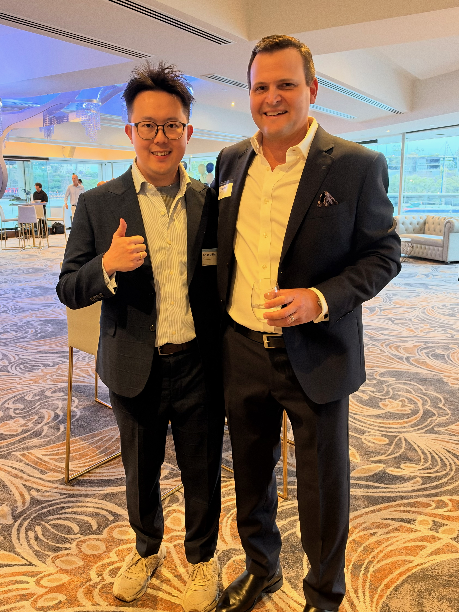

+++
date = '2026-11-05T00:00:00+00:00'
title = 'Bellwether 15th Anniversary: Fifteen Years, Built from the Ground Up'
tags = ['Sharing', 'Networking', '中文']
thumbnail = 'pic.png'
+++

Last Friday, I flew from Sydney to Brisbane for one evening: Bellwether's 15th anniversary. Thank you, Steve, for having me.

上週五傍晚，我從悉尼飛到布里斯本，參加一個晚上的聚會：Bellwether 的 15 週年。謝謝 Steve 的邀請。

## From the Ground Up // 從地基開始

Steve looked back on Bellwether's fifteen years: starting from zero, one project after another, building the company step by step.

Steve 在會上回顧了 Bellwether 這 15 年：從零開始，一個專案接著一個專案，把公司一步一步建立起來。

I can't retell every story from the night, but the feeling it left me with was clear. This is a company built from the ground up. No shortcuts, no overnight turning point. Just delivery after delivery, and trust earned one relationship at a time.

我沒辦法完整轉述每一段故事，但整段回顧給我的感受很清楚：這是一家白手起家的公司。沒有捷徑，也沒有一夜之間的轉折，靠的是一次又一次的交付，和一段又一段累積起來的信任。

That kind of long-term, roll-up-your-sleeves work inspired me. It is what I admire most, and what I most want to learn.

這種長期主義、踏實做事的打拼感很啟發我，也是我最欣賞、最想學習的地方。

## Two Ideas I Took Home // 帶回來的兩句話

I'm still tuning my ear to the Aussie accent, so I didn't catch every word. What follows is the gist as I understood it, not Steve's exact words. If I've got them slightly wrong, blame my ears, not Steve:

我的耳朵還在適應澳洲口音，那晚沒能聽懂每一句。下面兩句是我記下的大意，不是原話。如果理解有偏差，那是我耳朵的問題，不是 Steve 的：

- **Luck tends to find the people who have already put in the work.**
- **運氣，往往落在已經把功夫做足的人身上。**
 
    
- **Don't let your current size set the limit on your ambition.**
- **不要讓現在的規模，決定你野心的上限。**

## Scale Is a Starting Point, Not a Ceiling // 規模是起點，不是天花板

The second one has stayed with me.

第二句話，我想了很久。

Most long-term goals start small: one person, one project, a direction that isn't clear yet. Starting small is practical. But thinking small because you are small today is how you put a ceiling on your own future.

很多長期目標都是從很小的地方開始：一個人、一個專案、一個還不確定的方向。從小處開始是務實；但如果因為現在很小，就把目標也想小了，那就是自己替未來設了天花板。

Scale describes where you are now, not how far you can go.

規模描述的是你現在在哪裡，不是你最後能走到哪裡。

## One Year On // 一年之後

A little over a year ago, I had just moved from Taiwan to Sydney and went to my first industry event in Australia, knowing almost no one. In July this year, I met Steve at Bellwether's Sydney gathering. A few months later, I flew to Brisbane for their 15th anniversary.

一年多前，我剛從台灣搬到悉尼，第一次參加澳洲的業界活動，幾乎誰都不認識。今年 7 月，我在 Bellwether 的悉尼聚會上認識了 Steve。幾個月後，我飛了一趟布里斯本，參加他們的 15 週年。

I'm still near the starting line. What Bellwether's fifteen years made clear to me is that starting from zero isn't the problem. The question is whether you keep going, year after year.

我還在起點附近。Bellwether 的 15 年讓我看清楚：從零開始不是問題，問題是能不能一年一年地走下去。

## Finally // 最後

Congratulations to Steve and the whole Bellwether team on fifteen years.

恭喜 Steve 和整個 Bellwether 團隊走過 15 年。

> The celebration lasted one night. What held it up were the more than five thousand days before it.
>
> 15 週年的慶祝只有一個晚上，撐起這個晚上的，是之前的五千多個日子。

---
*© Chung-Hao Lee. All Rights Reserved.
All content on this webpage—including but not limited to text, images, design, code, and multimedia materials—is protected under the international copyright treaties. Unauthorized reproduction, modification, distribution, public transmission, or commercial use is strictly prohibited. Legal action will be taken against infringement.*  
*© 李崇豪。保留所有權利。
本網頁之內容（包括但不限於文字、圖片、設計、程式碼及多媒體素材）均受國際著作權條約保護。未經書面授權，嚴禁任何形式之複製、改作、散布、公開傳輸或商業利用。侵權者將依法追訴。*
