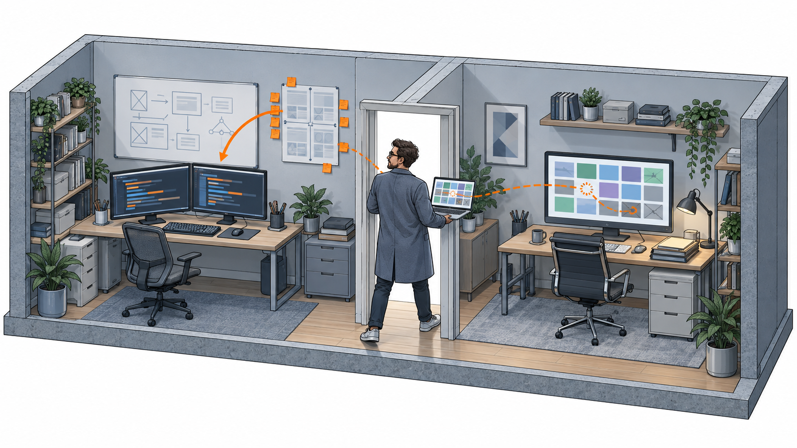
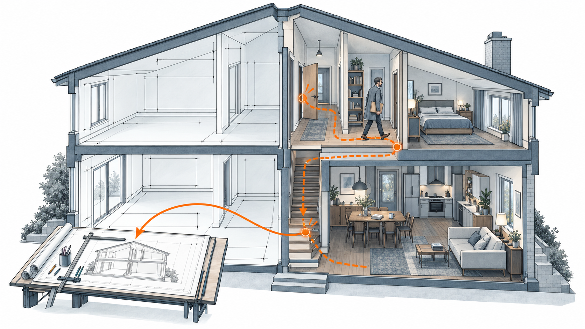
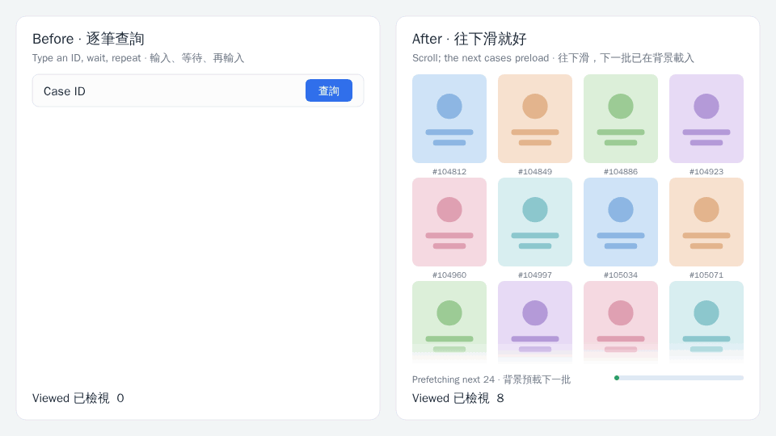
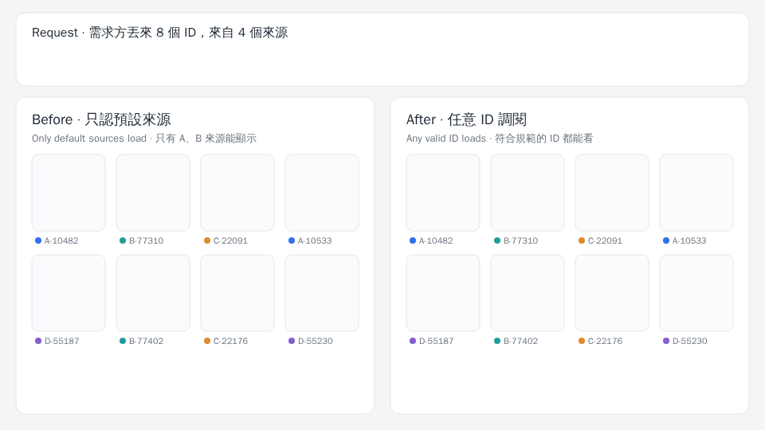

+++
date = '2026-10-27T00:05:00+00:00'
title = "Beyond the PRD: Why the Best Builders Are Also Users"
tags = ['Beyond the___', 'PM', '中文']
thumbnail = 'pic.png'
+++

In September I wrote that [*AI's Next Battle may Not be Intelligence, but Experience.*](/posts/ai_next_battle_is_experience/) Smartphones ran the same course. While rivals competed on megapixels and battery capacity, the iPhone won on how smooth it felt. Every swipe was designed to disappear.

九月，我寫過一篇[《AI's Next Battle may Not be Intelligence, but Experience.》](/posts/ai_next_battle_is_experience/)。智慧型手機走過同一條路：規格戰打得最兇的那幾年，各家比畫素、比電池毫安，iPhone 卻靠 iOS 那套絲滑的操作勝出。每一個動作都讓人越用越無感。

That piece left one question unanswered. Who decides whether an experience is good?

那篇留了一個問題沒回答：體驗好不好，誰說了算？

Not the spec sheet, and not the person who wrote it. The user decides, because the user has to live with the product every day. Users know what feels smooth and what grinds, and only a good experience brings them back.

不是規格表，也不是寫規格表的人，是使用者。每天要用它的是他們，哪裡順、哪裡卡，他們最清楚；也只有體驗好，他們才會一直回來。

The conclusion is simple, but acting on it is not. The best builder is also a user. Put the other way: if you build it, you should have to use it, because that is the only reliable way to feel where it hurts.

推到底，結論很簡單，做起來卻不容易：最好的開發者，自己也是使用者。換句話說，開發者也得是使用者，才知道痛點在哪、需求在哪。

For most of this year I have stood on both sides of one product. At work I lead an internal analysis platform, and I also use it, often all day. Two of its features came straight from my own frustration as a user. Neither would have appeared in a requirements doc.

今年大部分時間，我同時站在一個產品的兩邊。工作上，我負責一個內部分析平台；同時我也是它的使用者，常常一用就是一整天。平台上有兩個功能，都直接來自我當使用者時的不耐煩，也都不會出現在任何一張需求單上。

<figure style="margin: 2em 0;">
  
  <figcaption style="margin-top: .6em; font-size: .82em; line-height: 1.55; opacity: .7; text-align: left;">
    A blueprint shows how a house should work. Only living in it shows where it doesn't. 
    藍圖畫的是房子該怎麼運作；住進去，才知道哪裡不對勁。
  </figcaption>
</figure>

---

## The Case Wall: Not the Slowness, the Stopping // 瀑布屏：痛的不是慢，是停

Investigating cases is a volume game. One analysis can mean a few dozen cases, sometimes a few hundred.

看 case 是一場數量戰。一次分析，少則幾十個，多則幾百個。

The old flow went like this: type an ID, wait for it to load, look, then type the next ID and wait again. Each wait lasted a few seconds. Across a few hundred cases, the waiting became the work.

以前的流程是這樣：輸入一個 ID，等它加載，看完，再輸入下一個 ID，再等。每次只等幾秒，但幾百個 case 累積下來，等待本身就成了工作。

Nobody filed a ticket about it, because users had accepted it as part of the job. I only saw it because I was the one watching the spinner.

沒有人為此開過需求單，大家早就把它當成工作的一部分。我會看見，只是因為坐在螢幕前盯著轉圈圈的人就是我自己。

The fix was a case wall: an infinite-scrolling grid. You keep scrolling, and the next batch has already loaded in the background before you reach it. The spinner never appears. A few hundred cases went from a stop-start chore to one continuous motion.

解法是瀑布屏：把 case 排成一面可以一直往下滑的牆。你只管往下滑，下一批早已在背景載好，轉圈圈再也沒出現。幾百個 case，從走走停停，變成一路滑到底。

<figure style="margin: 2em 0;">
  
  <figcaption style="margin-top: .6em; font-size: .82em; line-height: 1.55; opacity: .7; text-align: left;">
    Left: type, wait, repeat. Right: keep scrolling while the next batch loads in the background. (Simulated interface.) 
    左：輸入、等待、再輸入；右：一路往下滑，下一批已在背景載好。（模擬介面）
  </figcaption>
</figure>

The fix wasn't about making each load faster. It was about making sure nobody had to wait. The loading still happens. It has moved into the seconds the user already spends on the current case, and it finishes quietly in the background.

這個解法的關鍵，不是讓每一次加載變快，而是讓使用者不必再等。加載其實還在，只是被挪到使用者正在看 case 的那幾秒裡，在背景悄悄完成。

Getting there took one distinction: the pain wasn't slowness, it was stopping. Every case ended in a pause, and every pause broke both the rhythm and the focus. If all you hear is "reviewing cases is slow," your instinct is to speed up loading. Make it twice as fast and people still have to stop. That difference never makes it into a requirements doc. Only someone who has waited through the cases one by one knows which part actually has to go.

要想到這一步，得先分清楚：痛的不是「慢」，是「停」。每看完一個就得停下來，節奏一斷，注意力也跟著斷。如果只聽到「看 case 很慢」，直覺會去優化加載速度，但就算快了一倍，人還是得停。這種差別寫不進需求單，只有自己一個一個等過的人，才知道真正該拿掉的是哪一段。

---

## Any-ID Lookup: Not a Missing Feature, a Missing Whole // 任意 ID 調閱：缺的不是功能，是完整

The second pain was quieter and more dangerous.

第二個痛點比較安靜，卻更致命。

Requests often arrived as a pile of IDs with a note: "Can you analyze these?" Those IDs came from many different sources. If a source wasn't one the platform supported by default, the case would not load.

需求方常常丟來一大串 ID：「幫我分析一下這些。」但這些 ID 來自四面八方，只要來源不是平台預設支援的，case 就加載不出來。

Last month, in [*Not One Super App, but Every Industry*](/posts/why-ais-second-half-will-be-won-on-experience/), I wrote about the race to own AI's front door. Red envelopes can buy this round, but what's worth winning is never this round; it is whether the other side still wants a next one. Internal platforms work the same way. A case you can't see here is a case you go and see somewhere else. Once users have to leave to finish a job, they rarely come back for the next one.

上個月我在[《Not One Super App, but Every Industry》](/posts/why-ais-second-half-will-be-won-on-experience/)裡談 AI 的入口之爭：各家砸紅包搶入口，紅包買得到這一局，但要贏的從來不是這一局，而是讓對方還願意有下一局。內部平台也一樣。看不到的 case，只能去別的地方看；使用者一旦得離開才能把事情做完，下一次就很少回來了。

So we built what I'll call any-ID lookup. Whatever the source, any ID in the standard format loads. Paste the pile, see the pile.

所以我們做了「任意 ID 調閱」：不管來源是哪裡，只要是符合規範的 ID，丟進來就看得到。整串貼上，整串打開。

<figure style="margin: 2em 0;">
  
  <figcaption style="margin-top: .6em; font-size: .82em; line-height: 1.55; opacity: .7; text-align: left;">
    The same eight IDs from four sources. Default sources only: half won't open. Any-ID lookup: all eight do. (Simulated interface.) 
    同樣 8 個、來自 4 個來源的 ID。只認預設來源，一半打不開；任意 ID 調閱，全部打開。（模擬介面）
  </figcaption>
</figure>

What made this matter is that users don't want "most of it loads." They want "all of it loads." If even a few IDs in the pile won't open, they have to open another system anyway, and once it's open they may as well finish the rest there. To a user, partial support is close to no support.

這個功能的關鍵在於，使用者要的不是「大部分能看」，而是「全部都能看」。一串 ID 裡只要有幾個打不開，他就得另外開一個系統；既然另一個系統都開了，剩下的 case 乾脆也在那裡看完。部分支援，在使用者眼裡幾乎等於不支援。

That is why closing the last few sources was worth far more than the few cases it recovered. For the first time, the platform could take a whole request from start to finish, and users finally had a reason to keep the whole job here.

所以補上最後那幾個來源，價值遠超過那幾個 case 本身。平台第一次能把一整份需求從頭接到尾，使用者也才第一次有理由，把整件事留在這裡做完。

---

## The Loop // 正循環

Neither feature was a growth tactic. Both were fixes to the experience. But a good experience compounds. People who stopped waiting used the platform more, and people who stopped leaving brought their requests with them. The platform now has a few dozen monthly users running well over ten thousand queries a month. Nobody was told to adopt it. They came because it was the easiest place to do the work.

這兩個功能都不是為了衝用戶數，只是為了把體驗做好。但好的體驗會複利：不用再等的人，用得更多；不用再離開的人，把需求一起帶了進來。現在這個平台每月有幾十位活躍使用者、上萬次查詢。沒有人被規定一定要用，他們會來，是因為在這裡做事最省力。

---

## Internal Tools Deserve a Good Experience Too // 內部平台，也值得好體驗

I've also heard a different view: it's an internal platform without many users, so as long as it works, it's fine. I understand that. Resources are finite, and internal tools often sit at the back of the queue. But this past year showed me two other things.

我也聽過另一種想法：內部平台嘛，使用者不多，做出來能用就好。這我能理解。資源有限，內部工具本來就常排在後面。只是這段經驗，讓我看到另外兩件事。

First, internal users do have a choice. Their alternative isn't another product. It is the way they used to work: a spreadsheet, another system, a familiar routine. Any-ID lookup taught me that when the platform can't hold the work, people drift back to the familiar path. That is nobody's fault. It's just human.

第一，內部使用者其實也有選擇。他們的替代方案不是另一個產品，而是原本的做法：一張 Excel、另一個系統、一套早已習慣的流程。任意 ID 調閱的經驗告訴我，平台只要接不住，大家很自然就會回到熟悉的路上。這不是誰的錯，只是人之常情。

Second, few users does not mean little use. Divide the queries by the users and each person uses the platform more than a dozen times every working day. Experience scales with frequency. A few seconds of waiting, a dozen times a day, every day, adds up. The reverse holds too: every small improvement is multiplied by the same frequency.

第二，人數少，不代表用得少。把查詢次數除以人數，平均每人每個工作天會用上十幾次。體驗的影響是跟著頻率放大的：幾秒鐘的等待，一天十幾次、天天如此，累積起來就很可觀。反過來說，每一個小改善，也會被同樣的頻率放大。

How many users you have decides how far the impact reaches. Whether the experience is worth getting right doesn't depend on the headcount.

使用者多寡，決定的是影響面有多廣；但體驗值不值得做好，其實不必看人數。

---

## Don't Just Architect, Inhabit — Revisited // 再談「別只當建築師」

Last year, in [*Beyond the Job Title*](/posts/2025-11-25-beyond-the-job-title-product-strategy-+-operations/), I wrote: don't just architect, inhabit. I meant it, but what I had was a slogan, not a mechanism.

去年我在[《Beyond the Job Title》](/posts/2025-11-25-beyond-the-job-title-product-strategy-+-operations/)寫過：別只當建築師，更要成為居住者。那時我是真心相信，但手上只有一句口號，沒有機制。

This year filled in the mechanism. Look back at both features and the pain wasn't inside either of them. It sat between features. The case wall's pain lived in the seconds between two cases. Any-ID lookup's pain lived in the jump between two systems. Test each feature on its own and each one works. Only when you carry a real job from start to finish do you fall into the gaps.

這一年把機制補上了。回頭看這兩個功能，痛點都不在任何一個功能裡面，而在功能與功能之間。瀑布屏的痛，在兩個 case 之間的那幾秒；任意 ID 調閱的痛，在兩個系統之間的那一次跳轉。把每個功能拆開來驗收，它們都能用；只有把一件真正的工作從頭做到尾，才會掉進那些縫隙裡。

That is why builders need to be users. Requirements docs record what users say out loud. Experience is decided in the places they never mention.

這也是為什麼開發者要是使用者。需求單記錄的，是使用者說出口的要求；體驗的好壞，卻往往取決於那些說不出口的地方。

So the best way to test a product isn't to try its features one by one. It is to use it to finish one real piece of work. Wherever it makes you stop, and wherever it makes you want to leave, that's the next thing to build.

所以，檢驗一個產品，最好的方法不是逐項試用功能，而是拿它完整做完一件真正的工作。哪裡讓你停下來，哪裡讓你想離開，那裡就是下一個該做的東西。

Architects read blueprints. The people who live in the house know which door sticks and which hallway takes the long way round.

建築師看的是藍圖，住進去的人，才知道哪扇門卡、哪條走廊繞。

Good products aren't drawn. They're lived in.

好產品從來不是畫出來的，是住出來的。

---
*© Chung-Hao Lee. All Rights Reserved.
All content on this webpage—including but not limited to text, images, design, code, and multimedia materials—is protected under the international copyright treaties. Unauthorized reproduction, modification, distribution, public transmission, or commercial use is strictly prohibited. Legal action will be taken against infringement.*  
*© 李崇豪。保留所有權利。
本網頁之內容（包括但不限於文字、圖片、設計、程式碼及多媒體素材）均受國際著作權條約保護。未經書面授權，嚴禁任何形式之複製、改作、散布、公開傳輸或商業利用。侵權者將依法追訴。*
