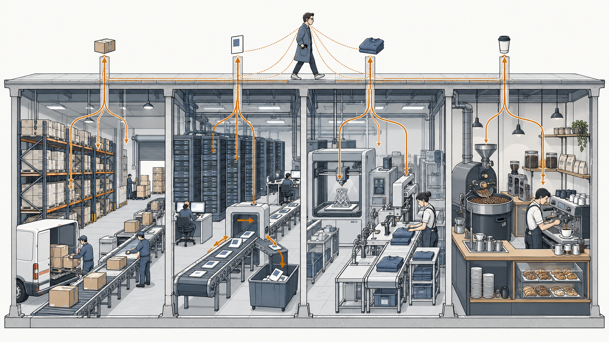
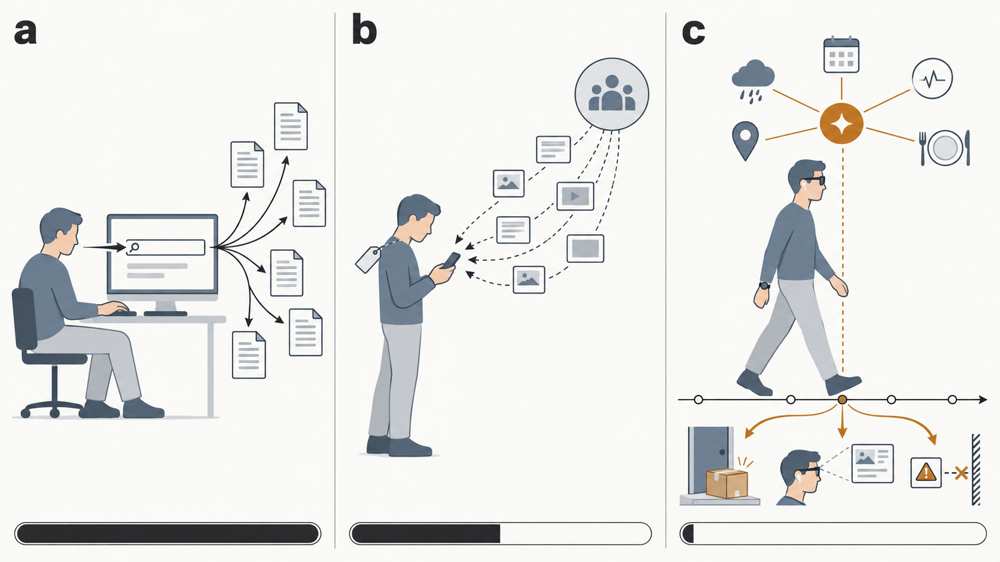
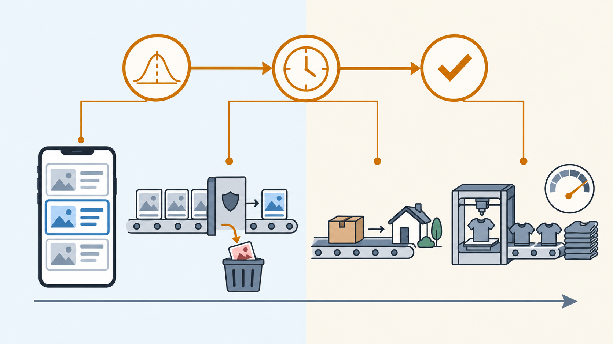
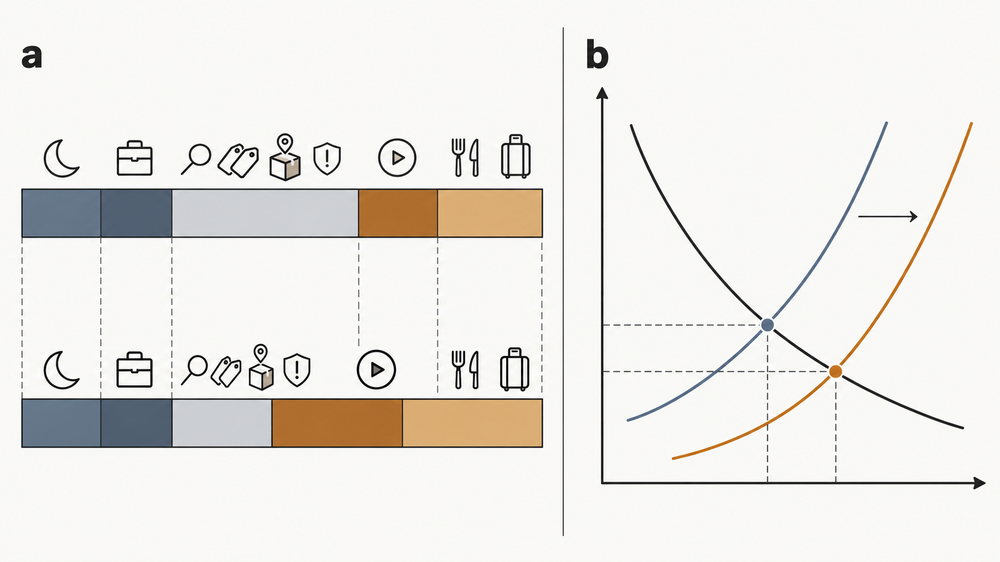

+++
date = '2026-10-13T00:05:00+00:00'
title = "Not One Super App, but Every Industry: Why AI's Second Half Will Be Won on Experience"
tags = ['AI', 'Passport to AI Era', '中文']
thumbnail = 'pic.png'
+++

The industry has settled on a tidy script for the AI era: the first half belongs to hardware, the second half to applications.

AI 時代有個流行的說法：上半場是硬體的主場，下半場是應用的主場。

This Lunar New Year showed what the second half looks like in practice. Alibaba's Qwen put up 3 billion yuan in red envelopes. Tencent's Yuanbao put up 1 billion; Baidu's Ernie, 500 million. It was the same play WeChat ran in 2015, when Spring Festival red envelopes turned a messaging app into a wallet. The prize, then and now, is the entrance: the one app people open first, through which everything else flows.

今年春節，下半場先露了臉。阿里千問砸了 30 億人民幣發紅包，騰訊元寶 10 億，百度文心 5 億。這一招並不陌生。2015 年春節，微信靠紅包把一個聊天軟體變成了錢包。十一年過去，大家搶的還是同一樣東西：入口，那個使用者第一個打開、其他一切都從它流過的 App。

Red envelopes can win this round. But as I wrote in [*Beyond Just Talking*](/posts/beyond_just_talking/), what is worth winning is never this round. It is whether the other side still wants a next one. And this race for the entrance rests, I think, on a wrong assumption.

紅包買得到這一局。但我在[《Beyond Just Talking》](/posts/beyond_just_talking/)寫過，要贏的從來不是這一局，而是讓對方還願意有下一局。而這場入口之爭，我認為從一開始就押錯了假設。

<figure style="margin: 2em 0;">
  
  <figcaption style="margin-top: .6em; font-size: .82em; line-height: 1.55; opacity: .7; text-align: left;">
    The entrance layer is thin; the weight sits in the industries beneath it. Personal devices perceive and anticipate. Delivery still belongs to every industry below. 
    入口層很薄，真正的重量在下面的各行各業。隨身裝置負責感知與預判，交付仍然靠每一個行業。
  </figcaption>
</figure>

---

## The Entrance Won't Swallow Everything // 入口吃不掉一切

There will be an entrance. In the near term it is a set of devices. In [*The AI Era May Need a New Division of Labor*](/posts/the-ai-era-may-need-a-new-division-of-labor/), I argued that the phone, earbuds and glasses will work as one personal AI system. Further out, as I wrote in [*When AGI Moves In*](/posts/when-agi-moves-in/), the interface keeps retreating toward the body, eventually into a brain-computer interface. Whoever owns that layer will matter.

入口會有。短期內，它是一組硬體。我在[《The AI Era May Need a New Division of Labor》](/posts/the-ai-era-may-need-a-new-division-of-labor/)寫過，手機、耳機、眼鏡會組成同一套個人 AI。再往後，就像[《When AGI Moves In》](/posts/when-agi-moves-in/)推演的，介面會一路往人身上退，最後走到腦機介面。誰握住這一層，當然重要。

But it will not swallow everything.

但它吃不掉一切。

The first reason is that the model underneath is converging. In [*AI's Next Battle may Not be Intelligence, but Experience.*](/posts/ai_next_battle_is_experience/), I pointed to a flagship launched under the banner "Welcome to the AGI era" whose Intelligence Index score was flat against the previous generation. When every vendor approaches the same ceiling, no single model gets to be the only door.

第一，底下的模型正在趨同。我在[《AI's Next Battle may Not be Intelligence, but Experience.》](/posts/ai_next_battle_is_experience/)提過，一款喊出「Welcome to the AGI era」的旗艦模型，智力指數和上一代打平。當每一家都逼近同一個天花板，就不會有哪個模型成為唯一的那扇門。

The second reason is that an entrance knows what you want; it does not make it. In that same piece I borrowed Andy from *The Devil Wears Prada*, the assistant who learns to put things on the table before Miranda finishes her sentence. Andy can have the coffee waiting before anyone asks for it. She can track down an unpublished Harry Potter manuscript before anyone else. But she doesn't roast the beans, and she doesn't publish the book. The best assistant in the world still depends on the café, the publisher, the courier. Anticipation is her job. Delivery belongs to everyone else.

第二，入口懂你要什麼，卻不負責把它做出來。那篇文章裡，我借了《穿著 Prada 的惡魔》的 Andy，那個學會在 Miranda 開口前就把東西放上桌的助理。咖啡還沒交代，她已經端上桌；還沒出版的哈利波特書稿，她比誰都先拿到。但咖啡豆不是她烘的，書也不是她出的。再好的秘書，也得靠咖啡店、出版社、快遞。預判是她的工作，交付屬於其他所有人。

That is what AI is shaping up to be: not one giant application, but a super-secretary working quietly in the background. Last year, in [*Beyond the Hype*](/posts/2025-09-23_human-insight-+-ai-is-the-real-competitive-edge/), I quoted Jack Ma: "AI will change everything — but that doesn't mean AI decides everything." In the same piece I called AI an amplifier. A year on, I would be more specific. AI amplifies industries. It does not replace them.

AI 正在變成的，也是這樣的角色：不是一個包山包海的大應用，而是一位潤物細無聲的超級秘書。去年我在[《Beyond the Hype》](/posts/2025-09-23_human-insight-+-ai-is-the-real-competitive-edge/)引過馬雲的一句話：「AI 將改變一切——但這不代表 AI 決定一切。」同一篇裡我寫，AI 只是放大器。一年後，我想說得更具體：AI 放大的是各行各業，而不是取代它們。

The division-of-labor piece ended on hardware: the defining AI device may not be a device at all. The same logic holds one level up. The defining AI application may not be an application at all.

《分工》那篇的結論是，AI 時代需要的可能不是一台新裝置，而是一套新的分工。同樣的邏輯往上推一層也成立：代表 AI 時代的應用，可能根本不是一個應用。

That points to a different strategy for the second half. Instead of fighting over the door, use AI to push the experience inside your own industry as far as it will go.

這指向下半場的另一種策略：與其搶門，不如用 AI 把自己這一行的體驗做到極致。

---

## From Search, to Feed, to Knowing You Right Now // 從人找資訊、資訊找人，到懂你此刻

What does "as far as it will go" look like? The clearest way to see it is to trace how information has reached us over the past three decades.

什麼叫做到極致？最清楚的方法，是回頭看資訊這三十年是怎麼來到我們面前的。

In the internet era, people went looking for information. You knew what you wanted, opened Yahoo and typed in keywords. In [*Product Decoder: Google's AI Pointer*](/posts/product-decoder_google-ai-pointer/), I called this cost the description tax: being forced to restate your intent in words before a machine will act on it. Search charged it in full.

網路時代，是人找資訊。你知道自己要什麼，打開 Yahoo，敲下關鍵字。我在[《Product Decoder: Google's AI Pointer》](/posts/product-decoder_google-ai-pointer/)把這種成本叫做「描述稅」：你得先用文字把意圖講清楚，機器才肯動。搜尋時代，這筆稅是全額由你付的。

In the mobile era, information came looking for people. TikTok doesn't wait for a query. It knows what you like and serves it. The tax dropped sharply. But the feed knows who you are. It doesn't know who you are right now.

行動網路時代，是資訊找人。TikTok 不等你開口，它知道你喜歡什麼，直接推到你眼前。描述稅大幅降低。但資訊流懂的是「你是誰」，不懂「你此刻怎麼了」。

The AI era closes that gap. It knows who you are right now. It holds "this time" and "three days ago" in the same frame. And instead of waiting to be asked, it steps in at the right moment, the shift from pull to ambient I described in *When AGI Moves In*. The tax falls to zero.

AI 時代補上的，正是這最後一段：懂你此刻。它會把「這一次」跟「三天前」放在一起看。它不等你召喚，而是在對的時機自己出手，也就是我在《When AGI Moves In》說的，從 pull 變成 ambient。描述稅，降到零。

What is left is an experience you barely notice. That isn't a shortcoming; it's the score. When something is smooth enough, you stop feeling it. You think of it, and it's done.

剩下的，是一種你幾乎感覺不到的體驗。這不是缺點，是滿分。體驗夠絲滑，你就感覺不到它的存在：心裡才想到，事情已經辦好了。

Nor will this be one app's story. It will play out inside industry after industry, each in its own vocabulary.

這也不會只是某一個 App 的故事。它會在一個又一個行業裡，用各自的語言上演。

<figure style="margin: 2em 0;">
  
  <figcaption style="margin-top: .6em; font-size: .82em; line-height: 1.55; opacity: .7; text-align: left;">
    <strong>Figure 1 | Three eras of information.</strong> <strong>a</strong>, Internet era: people search for information and pay the full description tax. <strong>b</strong>, Mobile era: information is pushed to people based on a fixed profile. <strong>c</strong>, AI era: context signals feed an anticipation layer that acts at the right moment, and the description tax approaches zero. Bottom bars show the description tax in each era (schematic). 
    <strong>圖 1｜資訊的三個時代。</strong><strong>a</strong>，網路時代：人找資訊，描述稅全額由人支付。<strong>b</strong>，行動時代：資訊依固定的偏好標籤推給人。<strong>c</strong>，AI 時代：情境訊號匯入預判層，在對的時機出手，描述稅趨近於零。底部長條為各時代的描述稅（示意）。
  </figcaption>
</figure>

---

## Four Industries, One Mechanism // 四個行業，同一個機制

<table>
  <thead>
    <tr>
      <th style="width:13%; text-align:left; vertical-align:top;">Scene 場景</th>
      <th style="width:25%; text-align:left; vertical-align:top;">Mobile Era 行動時代</th>
      <th style="width:42%; text-align:left; vertical-align:top;">AI Era AI 時代</th>
      <th style="width:20%; text-align:left; vertical-align:top;">What You Notice 你感受到的</th>
    </tr>
  </thead>
  <tbody>
    <tr>
      <td style="vertical-align:top;"><strong>Recommendation</strong> <strong>推薦</strong></td>
      <td style="vertical-align:top;">Personalized by person: past preferences sort you into a profile, and you get the same flavor whenever you open the app. 千人千面：依過去的偏好，把人分進不同標籤，同一個人不管何時打開，看到的都是同一套口味。</td>
      <td style="vertical-align:top;">Knows you right now: the same person gets different content at different times and in different settings. ・A rainy commute on a packed train: short clips that work on mute ・Just chewed out by the boss: no more workplace drama, something that lets you breathe instead ・Just had a great meal: similar spots nearby, or how to make the dish at home ・Evening on the couch: only now, the longer videos you can settle into  懂你此刻：同一個人，在不同時候、不同場合，推的內容不一樣。 ・下雨天擠捷運通勤：推短一點、不用開聲音的內容 ・剛被老闆罵完：不再推職場衝突，改推能讓心情鬆一口氣的東西 ・剛吃到一頓好吃的：推附近同類型的店，或教你在家做出這道菜 ・晚上窩在沙發：才推長一點、可以慢慢看的影片</td>
      <td style="vertical-align:top;">It serves what you need right now. 它推的，剛好是你這一刻需要的。</td>
    </tr>
    <tr>
      <td style="vertical-align:top;"><strong>Moderation</strong> <strong>內容審核</strong></td>
      <td style="vertical-align:top;">Armies of human reviewers plus user reports, mostly after the damage is done. 人海審核加上使用者檢舉，多半是事後補救。</td>
      <td style="vertical-align:top;">Runs around the clock, weighs borderline cases from every angle, and reads accounts, payments and content together. In 2024, Google suspended more than 39.2 million advertiser accounts, most before they served a single ad. 24 小時不間斷，邊緣案例從各個角度權衡，把帳號、金流、內容串在一起看。2024 年，Google 停權超過 3,920 萬個廣告主帳號，絕大多數在投出第一則廣告前就被攔下。</td>
      <td style="vertical-align:top;">Nothing. You never see the scam. 什麼都沒有。你根本沒看到那則詐騙。</td>
    </tr>
    <tr>
      <td style="vertical-align:top;"><strong>Logistics</strong> <strong>物流</strong></td>
      <td style="vertical-align:top;">Notifications tell you where your parcel is: information finding people, applied to a box. 推播一則則告訴你包裹到哪了，這是把「資訊找人」用在紙箱上。</td>
      <td style="vertical-align:top;">The box moves before you order. Inventory sits where demand will be next week, not where it was last month. Amazon patented "anticipatory package shipping" back in 2013. 還沒下單，箱子已經在路上。庫存不再放在上個月需求所在的地方，而是放在下週需求會出現的地方。Amazon 早在 2013 年就拿到「預期性出貨」專利。</td>
      <td style="vertical-align:top;">No waiting, no tracking. 不用等，也不用追。</td>
    </tr>
    <tr>
      <td style="vertical-align:top;"><strong>Production</strong> <strong>生產</strong></td>
      <td style="vertical-align:top;">Make first, then push discounts to clear whatever didn't sell. 先生產，賣不掉再推折扣清庫存。</td>
      <td style="vertical-align:top;">Design first, in pixels. AI-generated items are listed before they exist and made only once orders pass a threshold; flexible manufacturing and near-instant SKU changeovers scale the winners within days. In an Alibaba study, such items drew 13%+ higher click-through and conversion, and 7.9% fewer returns. 先在螢幕上設計：AI 生成的款式先上架，訂單過門檻才開工；靠彈性製造和快速換線，賣得好的款式幾天內就能加量。阿里的研究中，這類款式的點擊率和轉換率高出 13% 以上，退貨率低 7.9%。</td>
      <td style="vertical-align:top;">What you want simply exists. 你想要的東西，剛好存在。</td>
    </tr>
  </tbody>
</table>

Anyone who has run a production line knows how many hours vanish into changeovers. The AI era is pushing that number toward zero.

帶過產線的人都知道，一天有多少時間耗在換線上。AI 時代，正把這段時間往零推。

Notice the direction of travel. The first two scenes live on a screen; the last two move goods. Anticipation is leaving the feed and entering the supply chain.

注意這四個場景的走向：前兩個發生在螢幕上，後兩個開始搬動實體。預判正在離開資訊流，走進供應鏈。

And notice what the four share. In [*Beyond the Subjects*](/posts/beyond_the_subjects/), I argued that the walls between disciplines are in the org chart, not in the world. Here it is again: four industries, one mechanism. Predict, time it right, execute out of sight. That is why AI doesn't need to be one application. The same principle plugs into every industry under a different name.

也注意它們的共同點。我在[《Beyond the Subjects》](/posts/beyond_the_subjects/)寫過，牆在組織圖裡，不在世界裡。這裡又是同一件事：四個行業，同一個機制，就是預測、抓準時機、在你看不見的地方執行。所以 AI 不需要是一個應用：同一個原理，換個名字，就能插進每一個行業。

<figure style="margin: 2em 0;">
  
  <figcaption style="margin-top: .6em; font-size: .82em; line-height: 1.55; opacity: .7; text-align: left;">
    <strong>Figure 2 | Four industries, one mechanism.</strong> The same sequence (predict, time it, execute) plugs into recommendation, moderation, logistics and production, moving from information on screens (left) to physical goods (right). 
    <strong>圖 2｜四個行業，同一個機制。</strong>預測、抓時機、執行，同一套流程插進推薦、審核、物流與生產，從螢幕上的資訊（左）一路走到實體商品（右）。
  </figcaption>
</figure>

---

## Where the Time Goes // 省下來的，去了哪裡

The four scenes share one more thing. Each hands something back: time and energy to the person, cost savings to the system. So where does it go?

這四個場景還有一個共同點：它們都還了些東西回來，把時間和精力還給人，把成本省給整個系統。這些省下來的，去了哪裡？

Start with what doesn't change. In the AI Pointer piece, I wrote that humans are the source of the demand and the judge of the value. AI doesn't consume; people do. People haven't gone anywhere, so experience hasn't either, and neither has consumption. The value of all this anticipation doesn't settle at the entrance. It settles wherever people spend.

先看不變的部分。我在 Pointer 那篇寫過：「需求的源頭是人，價值的裁判也是人。」AI 不消費，消費的是人。人沒有消失，體驗就還在，消費也就還在。這些預判創造出的價值，不會停在入口，而會落在人花錢的地方，也就是各行各業。

Then look at what does change. AI takes over the hours once spent searching, comparing prices, tracking parcels and second-guessing whether a deal is a scam. That time and attention don't disappear. They flow toward content, entertainment and experiences, the things people actually want to spend on.

再看改變的部分。過去花在搜尋、比價、追包裹、懷疑這是不是詐騙的時間，被 AI 接手了。這些時間和注意力不會憑空消失，而會流向內容、娛樂和各種體驗，那些人們真正願意花時間的地方。

Time isn't money, of course. But the production side is pulling prices down: less waste, fewer returns, nothing made that nobody wants. Cathie Wood has argued for years that AI is deflationary, and the mechanism is not exotic. When goods get cheaper, by the oldest law in economics, more of them get bought.

當然，時間不等於錢。但生產端正在把價格往下壓：浪費更少，退貨更少，沒人要的東西根本不會被做出來。木頭姐 Cathie Wood 多年來一直主張 AI 會帶來通縮，背後的機制並不玄：東西變便宜，按照最古老的供需法則，買的量就會變多。

So both constraints loosen at once: more free time, lower prices. Consumption in the AI era shouldn't shrink; it should grow. That is exactly why experience matters. The time and money set free will flow to whoever makes the experience smoothest.

時間和錢這兩條約束，同時鬆開了。AI 時代的消費不會萎縮，反而應該成長。這也正好說明了體驗為什麼重要：被釋放出來的時間和錢，會流向體驗做得最絲滑的那一方。

<figure style="margin: 2em 0;">
  
  <figcaption style="margin-top: .6em; font-size: .82em; line-height: 1.55; opacity: .7; text-align: left;">
    <strong>Figure 3 | AI loosens both constraints on consumption.</strong> <strong>a</strong>, Time: hours once spent on chores (searching, comparing prices, tracking parcels, screening scams) shrink and flow to content, entertainment and experiences. <strong>b</strong>, Price: lower production costs shift supply outward; prices fall and quantity rises. Schematic, not actual data. 
    <strong>圖 3｜AI 同時鬆開消費的兩條約束。</strong><strong>a</strong>，時間：花在搜尋、比價、追包裹、辨別詐騙的瑣事時間縮短，流向內容、娛樂與體驗。<strong>b</strong>，價格：生產成本下降，供給曲線右移，價格下降、成交量上升。示意圖，非實際數據。
  </figcaption>
</figure>

---

## Not the Door, but What's Behind It // 不是那扇門，而是門後面

So the script is half right. The first half was hardware. But the second half is neither applications nor the entrance. It is experience. Last month I argued that AI's next battle may not be intelligence. This takes the same argument one step further: what matters is not the door, but everything that happens on the other side of it, in every industry.

所以那個說法只對了一半。上半場確實是硬體；但下半場既不是應用，也不是入口，而是體驗。一個多月前我說，AI 的下一場仗可能不是智力；這一回再往前推一步：關鍵不在那扇門，而在門後面，每一個行業裡發生的事。

Ask someone who has worked with a great assistant what that assistant actually did, and they'll struggle to tell you. They only remember that things got done.

問一個和頂尖助理共事過的人，那位助理到底做了什麼，多半說不上來。只記得，事情都辦好了。

---

### References // 參考資料

- Chung-Hao Lee, [*Beyond Just Talking: Communication Starts Before You Speak*](/posts/beyond_just_talking/) (2026)
- Chung-Hao Lee, [*The AI Era May Need a New Division of Labor, Not a New Device*](/posts/the-ai-era-may-need-a-new-division-of-labor/) (2026)
- Chung-Hao Lee, [*When AGI Moves In: The Two-Stage Roadmap to Human-AGI Coexistence*](/posts/when-agi-moves-in/) (2026)
- Chung-Hao Lee, [*AI's Next Battle may Not be Intelligence, but Experience.*](/posts/ai_next_battle_is_experience/) (2026)
- Chung-Hao Lee, [*Beyond the Hype: Human Insight + AI is the Real Competitive Edge*](/posts/2025-09-23_human-insight-+-ai-is-the-real-competitive-edge/) (2025)
- Chung-Hao Lee, [*Product Decoder: Google's AI Pointer — Where Human-AI Interaction Goes Next*](/posts/product-decoder_google-ai-pointer/) (2026)
- Chung-Hao Lee, [*Beyond the Subjects: The Walls Are in the Org Chart, Not in the World*](/posts/beyond_the_subjects/) (2026)

---
*© Chung-Hao Lee. All Rights Reserved.
All content on this webpage—including but not limited to text, images, design, code, and multimedia materials—is protected under the international copyright treaties. Unauthorized reproduction, modification, distribution, public transmission, or commercial use is strictly prohibited. Legal action will be taken against infringement.*  
*© 李崇豪。保留所有權利。
本網頁之內容（包括但不限於文字、圖片、設計、程式碼及多媒體素材）均受國際著作權條約保護。未經書面授權，嚴禁任何形式之複製、改作、散布、公開傳輸或商業利用。侵權者將依法追訴。*
